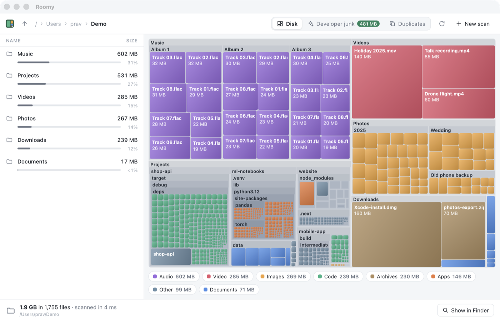

# Roomy: learn Rust by building a disk space analyser you'll actually use

Your disk is full again. Something is eating it, and you don't know what. This tutorial teaches you Rust from scratch by building **Roomy**, a fast desktop app that answers that question. It scans a disk in seconds, draws what it finds as a treemap, and hunts down the developer junk (`node_modules`, `target/`, `.venv`, Xcode's DerivedData, package caches) that you can throw away without a second thought.



By the end you'll have a real product. It's small, it's quick, and it runs on macOS, Windows and Linux. The last part of the tutorial ships it: installers, code signing, automatic updates, and Homebrew, winget, Scoop, Flathub, the AUR and crates.io.

Roomy is by Pravin Paratey. Its home is [github.com/pravin/roomy](https://github.com/pravin/roomy).

## What it does

- **Scans fast.** It uses every core you have. On an Apple Silicon Mac it adds up half a million files in under three seconds, about three times quicker than `du`.
- **Shows you where the space went.** A treemap gives every file a box sized by how much space it takes, coloured by type, with folders nested inside folders. Click to pick a box, double-click to go inside.
- **Finds developer junk.** It finds build folders and caches that your tools will happily make again, totals them up, and moves the lot to the Trash in one go.
- **Finds duplicates.** It looks for files that are byte for byte the same, without reading every byte of every file.
- **Is safe.** Nothing is ever deleted outright. It all goes to the Trash or Recycle Bin, and you can put it back.
- **Feels like a proper desktop app.** It has a native menu bar with keyboard shortcuts for everything: scan a folder (⌘O), scan again (⌘R), switch views (⌘1 to ⌘3), go up a folder (⌘↑), show in Finder, copy a path, move to the Trash (⌘⌫).
- **Has a command line tool too.** `roomy ~/Code`, `roomy junk --clean` and `roomy dupes` do the same jobs in a terminal.

## How it works

Every chapter is a folder you can build on its own. Chapter 2 starts from a copy of chapter 1 and adds to it, chapter 3 starts from chapter 2, and so on, so the last folder is the finished program. Each folder has a `README.md` with the lesson. Read it right here on GitHub, then run the code next to it. If you get stuck, open the next folder and see how I did it.

You need to have programmed before, in any language. You don't need to know any Rust. That's what we're here for. [Chapter 1](chapters/01-hello-cargo/README.md) explains how to install it.

From chapter 4 on, Roomy is a [Tauri](https://tauri.app) app. Rust does the real work: scanning, laying out the treemap, finding junk and duplicates. A thin TypeScript page draws the results in the system's own web view. There's no Electron and no bundled browser, so the finished app is a few megabytes.

To run a chapter from 4 onwards:

```text
cd chapters/12-drawing-the-treemap/app
npm install
npm run tauri dev
```

And its command line tool, from the chapter folder:

```text
cargo run --release -p roomy -- ~/Code
```

## The chapters

### Part 1: Getting started

Cargo, files and folders, errors, and a window.

1. [Hello, Cargo](chapters/01-hello-cargo/README.md)
2. [Walking a folder](chapters/02-walking-a-folder/README.md)
3. [When things go wrong](chapters/03-when-things-go-wrong/README.md)
4. [A window of your own](chapters/04-a-window-of-your-own/README.md)

### Part 2: The scanner

Trees, threads, live progress, and the truth about file sizes.

5. [A tree Rust is happy with](chapters/05-a-tree-rust-is-happy-with/README.md)
6. [Going parallel](chapters/06-going-parallel/README.md)
7. [Live progress](chapters/07-live-progress/README.md)
8. [Sizes that don't lie](chapters/08-sizes-that-dont-lie/README.md)
9. [Race day](chapters/09-race-day/README.md)

### Part 3: Seeing it

A list you can browse, a treemap you can click, and colours that mean something.

10. [The list view](chapters/10-the-list-view/README.md)
11. [Squarified treemaps](chapters/11-squarified-treemaps/README.md)
12. [Drawing the treemap](chapters/12-drawing-the-treemap/README.md)
13. [File types](chapters/13-file-types/README.md)

### Part 4: Cleaning up

Deleting safely, developer junk, and duplicate files.

14. [Safe delete](chapters/14-safe-delete/README.md)
15. [Developer mode](chapters/15-developer-mode/README.md)
16. [Duplicates](chapters/16-duplicates/README.md)

### Part 5: Ship it

Settings, installers, signing, updates, and getting it into people's package managers.

17. [Settings and polish](chapters/17-settings-and-polish/README.md)
18. [Installers and signing](chapters/18-installers-and-signing/README.md)
19. [Auto-update](chapters/19-auto-update/README.md)
20. [Package managers](chapters/20-package-managers/README.md)

## Installing Roomy

The release workflow in [`.github/workflows/release.yml`](.github/workflows/release.yml) builds installers for every platform whenever a version tag is pushed. Once a release is out, download it from the [releases page](https://github.com/pravin/roomy/releases). The Homebrew, winget, Scoop, AUR and Flathub manifests are in [`chapters/20-package-managers/packaging`](chapters/20-package-managers/packaging), and chapter 20 explains how to get them listed.

## Also by me

If you'd rather learn how Windows programs work underneath, [DrawLite](https://github.com/pravin/win32) is a twenty chapter tutorial that builds a paint program in C with nothing but the Win32 API.

## Licence

The code is released under the [Apache License 2.0](LICENSE). If you use it in something of your own, keep the [`NOTICE`](NOTICE) file with it. The text of the tutorial is by Pravin Paratey and is released under [CC BY 4.0](https://creativecommons.org/licenses/by/4.0/).

## Testing, honestly

Every chapter builds without warnings and passes its tests (`cargo clippy -- -D warnings` and `cargo test`) on macOS, and I've used the finished app on real disks with millions of files. The GitHub Actions workflow in [`.github/workflows/ci.yml`](.github/workflows/ci.yml) builds and tests every chapter on Linux, macOS and Windows on each push. Windows and Linux haven't had the same hands-on use as macOS yet, so if something behaves differently there, please [open an issue](https://github.com/pravin/roomy/issues).
