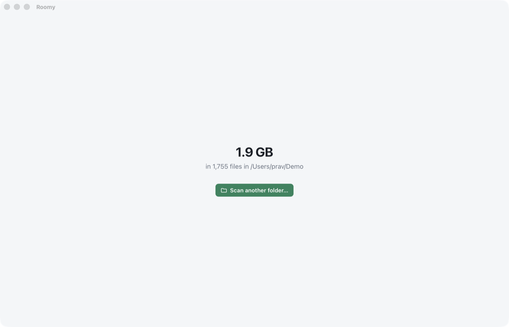

# Chapter 4 - A window of your own

[< Chapter 3: When things go wrong](../03-when-things-go-wrong/README.md)

Roomy can add up a disk now. But it lives in a terminal, and most people who need to know what's filling their disk will never open one. This chapter gives it a window.

It's a big chapter, because there's a lot of setting up to do. We split Roomy into a library and two programs, the command line tool you already have and a desktop app. We meet Tauri, the toolkit that turns a Rust program and a web page into a desktop app. And we connect the two, so a button on the page runs our Rust code and shows the answer. After this chapter the setting up is done, and every chapter after is about Roomy itself.

In this chapter you will

- turn one project into a Cargo *workspace* of three crates,
- make a library crate and use it from two programs,
- let the `thiserror` crate write our `Display` code,
- install what Tauri needs, and run a Tauri app,
- write a Tauri *command* and call it from TypeScript,
- see why a slow command is `async` and runs on a thread of its own,
- use `serde` to send Rust values to the page as JSON.

## Before we begin

### What's in the folder now

```text
04-a-window-of-your-own/
  Cargo.toml              The workspace: lists the three crates below
  core/                   roomy-core, a library: the scanner. No user interface at all
    src/lib.rs
    src/scan.rs           Chapter 3's scan, moved here
    src/size.rs           Chapter 3's format_size, moved here
  cli/                    roomy, the command line program
    src/main.rs
  app/                    The desktop app
    index.html            The page
    src/main.ts           The page's code
    src/api.ts            Typed wrappers for the Rust commands
    src/dom.ts, icons.ts  Small helpers
    src/style.css         How it looks
    src-tauri/            roomy-app, the Rust half of the desktop app
      src/main.rs
      src/commands.rs
      tauri.conf.json
      capabilities/default.json
```

A word on `style.css` and `icons.ts`. They're already the finished versions from the last chapter, with styles and icons for things we haven't built yet. This is a Rust tutorial, so we won't go through the CSS. Change it as much as you like.

### What you need to install

Tauri apps have two halves: a Rust program, and a web page it shows in a window. The page is built with the usual web tools, so you need **Node.js 22** or later from [nodejs.org](https://nodejs.org) (or your package manager). Check with `node --version`.

Each operating system needs a little more.

- **macOS.** Apple's command line tools, which you installed for chapter 1. That's it. Tauri uses the WebKit that comes with macOS.
- **Windows.** The MSVC build tools from chapter 1, and **WebView2**. Windows 10 and 11 already have WebView2; if yours somehow doesn't, get the *Evergreen Bootstrapper* from Microsoft.
- **Linux.** WebKitGTK and friends. On Debian or Ubuntu:

  ```text
  sudo apt install libwebkit2gtk-4.1-dev build-essential curl wget file libxdo-dev libssl-dev libayatana-appindicator3-dev librsvg2-dev
  ```

  The [Tauri prerequisites page](https://tauri.app/start/prerequisites/) has the list for Fedora, Arch and others.

### Running it

From the chapter folder:

```text
cd chapters/04-a-window-of-your-own/app
npm install
npm run tauri dev
```

`npm install` downloads the JavaScript side's tools into `app/node_modules`. (Yes, Roomy has a `node_modules` folder. In chapter 15 it'll find it.) `npm run tauri dev` builds the Rust half, starts a development server for the page, and opens the window. The first build takes a few minutes, because Tauri is a lot of crates. After that it's quick.

You should see Roomy's logo and a **Choose a folder…** button. Click it, pick a folder, and a moment later Roomy tells you how big it is.



The command line tool still works too, from the chapter folder:

```text
cargo run --release -p roomy -- ~/Downloads
```

`-p roomy` says which crate in the workspace to run.

To run the tests, use `cargo test -p roomy-core`. A plain `cargo test` tries to build every crate, including the app, and the app wants the finished web page to be there. Run `npm run build` in `app/` first if you want to test everything at once.

## Breaking it up

### A workspace

Until now Roomy was one crate: one `Cargo.toml`, one program. Now we want the same scanner in two programs, a command line tool and a desktop app. Copying the code would be asking for trouble, so we put it in a *library* crate that both programs use, and group all three in a *workspace*.

```toml
[workspace]
members = ["core", "cli", "app/src-tauri"]
resolver = "2"

[workspace.package]
version = "1.0.0"
edition = "2024"
license = "Apache-2.0"
authors = ["Pravin Paratey"]
repository = "https://github.com/pravin/roomy"

[workspace.dependencies]
roomy-core = { path = "core" }
thiserror = "2"
serde = { version = "1", features = ["derive"] }

[profile.release]
lto = true
codegen-units = 1
strip = true
```

The top-level `Cargo.toml` has no `[package]`. It's just a list of members, and some things they all share. `[workspace.package]` holds the version, licence and so on, and each crate says `version.workspace = true` to use them. `[workspace.dependencies]` pins each library's version in one place, so the three crates can never disagree about which `serde` they're using. A crate picks one up with `serde.workspace = true`.

All the crates in a workspace share one `target/` folder and one `Cargo.lock`, the file that records the exact version of every dependency. That's why the app and the command line tool always build with exactly the same scanner.

`roomy-core = { path = "core" }` is how the programs find the library: not on crates.io, but in the folder next door.

`[profile.release]` makes release builds smaller and a little faster. `lto` (*link time optimisation*) lets the compiler optimise across crates. `codegen-units = 1` gives it the whole program to look at in one go, at the cost of a slower build. `strip` leaves debugging symbols out of the finished program. We'll see the result in chapter 18.

### The library

`core/src/lib.rs` is the front door of the library.

```text
1  //! Everything Roomy knows about disks, with no user interface attached.
2  //! The command line tool and the desktop app both sit on top of this crate.
3
4  pub mod scan;
5  pub mod size;
6
7  pub use scan::{ScanError, Totals, scan};
8  pub use size::format_size;
```

A file called `lib.rs` (instead of `main.rs`) makes a crate a library. `//!` comments describe the thing they're inside, here the whole crate.

`pub mod scan;` [line 4] says there's a module called `scan`, and Rust finds its code in `scan.rs` next door. `pub` makes it visible outside the crate. Everything in Rust is private unless you say `pub`, which keeps a library's insides its own business.

`pub use` [lines 7 and 8] re-exports the handful of things most users want, so they can write `roomy_core::scan` instead of `roomy_core::scan::scan`. (Crate names use `-` in `Cargo.toml` and `_` in code. `roomy-core` is `roomy_core`.)

### thiserror

`core/src/scan.rs` is chapter 3's scanner, made public, with one change.

```text
 8  #[derive(Debug, thiserror::Error)]
 9  pub enum ScanError {
10      #[error("can't read {path}: {source}")]
11      Io {
12          path: PathBuf,
13          source: std::io::Error,
14      },
15      #[error("{0} is not a folder")]
16      NotAFolder(PathBuf),
17  }
```

Remember the `impl fmt::Display` and `impl std::error::Error` we wrote by hand last time? The `thiserror` crate writes both for us. `#[derive(thiserror::Error)]` does the deriving, and each `#[error("...")]` gives the message for that variant, with the variant's fields filled in by name, or by number for `{0}`. It's exactly the code we wrote in chapter 3. You just don't have to look at it. As a bonus, because the field is called `source`, `thiserror` tells the `Error` trait that the I/O error is the *cause* of ours, so tools that print chains of errors can show both.

Why use a crate for something we could write? Because every Rust error type needs the same boilerplate, `thiserror` is one of the most used crates there is, and it disappears when the code compiles. It costs nothing at run time.

```text
20  #[derive(Clone, Copy, Debug, Default, PartialEq, Serialize)]
21  pub struct Totals {
22      pub bytes: u64,
23      pub files: u64,
24      /// Things we weren't allowed to read.
25      pub errors: u64,
26  }
```

`Totals` derives a few more traits now. `Clone` and `Copy` mean it can be copied freely, like a number. It's just three numbers, after all. `Serialize` comes from `serde`, and we'll get to it in a moment. And every field is `pub` now, because the programs using the library need to read them.

### The command line tool

`cli/src/main.rs` is chapter 3's `main`, with the scanner gone.

```text
 5  use roomy_core::format_size;
...
14      match roomy_core::scan(&path) {
```

That's all it takes to use the library. The crate is named `roomy`, so the program it builds is called `roomy` too.

### Tauri

Now the window. There are two popular ways to make a desktop app with web pages. **Electron** ships a whole copy of Chrome inside every app, which is why a chat app can be 200 MB. **Tauri** uses the web view that's already part of the operating system (WebKit on macOS, WebView2 on Windows, WebKitGTK on Linux), and the code behind the page is Rust instead of Node.js. A Tauri app is a few megabytes, starts quickly, and uses little memory. For an app whose whole point is saving disk space, that's rather the point.

The two halves talk by message. The page asks Rust to do something by calling a *command*. Rust answers with a value, sent across as JSON. Later on Rust will also send *events* to the page without being asked, to say how a scan is going.

Let's start with the Rust half.

### The Rust half

`app/src-tauri` is an ordinary Rust crate, `roomy-app`. Its `Cargo.toml` asks for `tauri`, the dialog plugin (for the folder picker), and our library. There's also a *build script*, `build.rs`.

```text
1  fn main() {
2      tauri_build::build()
3  }
```

Cargo runs a crate's `build.rs` before compiling the crate itself. Tauri's reads `tauri.conf.json` and the capabilities, checks them, and prepares the app's icons and settings to be built into the program.

Here's `main.rs`.

```text
 1  // Don't open a console window next to the app on Windows, in release builds.
 2  #![cfg_attr(not(debug_assertions), windows_subsystem = "windows")]
 3
 4  mod commands;
 5
 6  fn main() {
 7      tauri::Builder::default()
 8          .plugin(tauri_plugin_dialog::init())
 9          .invoke_handler(tauri::generate_handler![commands::scan])
10          .run(tauri::generate_context!())
11          .expect("Roomy couldn't start");
12  }
```

Line 2 is for Windows. A Windows program is either a console program or a GUI program, and Rust makes console programs, so without this you'd get a black window next to Roomy. `cfg_attr(not(debug_assertions), ...)` applies the attribute only in release builds, so in development the console stays, and you can see anything we print.

`tauri::Builder` [line 7] sets the app up, one method at a time. This is called the *builder pattern*: each method changes one thing and hands the builder back, so you can chain them. We add the dialog plugin [line 8], list the commands the page is allowed to call [line 9], and start it [line 10]. `generate_context!` is a macro that bakes in `tauri.conf.json`, the icons and, in a release build, the whole web page, so the finished app is one file. `run` only returns when the app quits.

### A command

```text
 9  /// Adds up everything in a folder.
10  #[tauri::command]
11  pub async fn scan(path: PathBuf) -> Result<Totals, String> {
12      // Scanning takes a while and blocks the thread it's on, so it goes on a
13      // thread of its own, away from the ones Tauri uses to answer the window.
14      tauri::async_runtime::spawn_blocking(move || roomy_core::scan(&path))
15          .await
16          .map_err(|e| e.to_string())?
17          .map_err(|e| e.to_string())
18  }
```

`#[tauri::command]` [line 10] turns an ordinary function into something the page can call. It writes the code that reads the arguments from JSON (here, a `path`), calls the function, and turns the answer back into JSON. If the function returns `Ok`, the page gets the value; if it returns `Err`, the page gets an error. Errors have to be turned into JSON too, and the simplest way is to send them as text, which is why the error type is `String`.

The interesting part is lines 14 to 17. Scanning a big folder takes seconds. If the command just called `roomy_core::scan`, it would hold up whatever thread it was running on for all that time. Tauri needs its threads to keep the window responsive and to answer other calls. So we hand the scan to a thread kept specially for slow, blocking work.

`async fn` [line 11] makes `scan` an *asynchronous* function. Calling it doesn't run it straight away; it gives back a *future*, a task that can pause while it waits for something and let the thread do other work in the meantime. Tauri runs the future for us. `spawn_blocking` starts our closure on a separate thread and gives back a future that finishes when the closure does. `.await` [line 15] is where our function pauses until then, without holding up anything else.

`move` before the closure means the closure takes ownership of what it uses, here `path`. It has to. The closure runs on another thread, and might still be running after `scan` has paused, so it can't borrow something that lives in `scan`. It must own it. Rust checks this, and won't compile the program without `move`.

What comes back has two layers of `Result`. The outer one says whether the thread itself was all right (it fails only if the scan panicked). The inner one is the scan's own `Result<Totals, ScanError>`. Line 16 turns the outer error into text and unwraps it with `?`; line 17 turns the inner error into text and returns the result. `e.to_string()` works on any type with `Display`, which, thanks to `thiserror`, ours has.

### serde

`Totals` has to cross from Rust to TypeScript as JSON. That's what the `Serialize` we derived in `scan.rs` is for.

`serde` (*serialise, deserialise*) is how Rust turns values into JSON and dozens of other formats, and back. `#[derive(Serialize)]` writes the code to turn a `Totals` into whatever format is asked for. Tauri asks for JSON, and the page receives

```json
{ "bytes": 3409834612, "files": 1288, "errors": 0 }
```

The derive happens at compile time, and the code it writes is about as fast as anything you'd write by hand.

### Allowed to do what?

```json
{
  "$schema": "../gen/schemas/desktop-schema.json",
  "identifier": "default",
  "description": "What the Roomy window is allowed to do",
  "windows": ["main"],
  "permissions": [
    "core:default",
    "dialog:default"
  ]
}
```

A Tauri page can't do anything it hasn't been given permission for. `capabilities/default.json` lists what the `main` window may use: the core features, and the dialog plugin's defaults, which include the folder picker. If the page tried to call something else, Tauri would refuse. It's a good habit for an app that looks at all your files: if someone ever managed to get a script into the page, it couldn't do anything we hadn't allowed.

Our own commands don't need to be listed here. They're allowed because we registered them with `generate_handler!`.

### tauri.conf.json

`tauri.conf.json` describes the app: its name, its identifier, how to build the page, and its window.

```json
  "build": {
    "beforeDevCommand": "npm run dev",
    "devUrl": "http://localhost:1420",
    "beforeBuildCommand": "npm run build",
    "frontendDist": "../dist"
  },
```

In development Tauri starts `npm run dev`, which runs [Vite](https://vite.dev), a development server, on port 1420, and shows the page from there. Change the TypeScript and the page reloads by itself. Change the Rust and Tauri rebuilds and restarts the app. For a real build it runs `npm run build` and builds the page into `dist/`.

The `app` section makes one window, 1180 by 760, labelled `main` (that's the label the capability refers to). The `security` section sets a *content security policy*, which tells the web view to load nothing but our own page. No scripts from the internet, ever.

### The TypeScript half

The page itself is `index.html`, with three screens: start, scanning and results. Only one shows at a time.

```text
32      <section id="results" class="screen" hidden>
33        <div class="start">
34          <header class="hero">
35            <h1 id="total"></h1>
36            <p id="summary"></p>
37          </header>
```

`api.ts` is where the page calls Rust.

```text
 4  import { invoke } from "@tauri-apps/api/core";
 5
 6  export interface Totals {
 7    bytes: number;
 8    files: number;
 9    errors: number;
10  }
11
12  export const scan = (path: string) => invoke<Totals>("scan", { path });
```

`invoke` calls a command by name, with its arguments as an object. The names must match: `"scan"` is the Rust function's name, and `path` is its argument's name. `invoke` returns a promise of whatever the command sends back. The `Totals` interface describes it for TypeScript, so a typo like `totals.bites` is caught before the app runs. Keeping every call in one file means that when a command changes in Rust, there's one place to change it in TypeScript.

And `main.ts` uses it.

```text
16  async function scan(path: string) {
17    $("#scan-current").textContent = path;
18    showScreen("scanning");
19    try {
20      const totals = await api.scan(path);
21      $("#total").textContent = formatSize(totals.bytes);
22      $("#summary").textContent =
23        `in ${formatCount(totals.files)} files in ${path}` +
24        (totals.errors > 0 ? `. ${formatCount(totals.errors)} things couldn't be read.` : "");
25      showScreen("results");
26    } catch (error) {
27      message(String(error), { title: "Roomy", kind: "error" });
28      showScreen("start");
29    }
30  }
```

Show the scanning screen, call Rust, wait, show the answer. If Rust returned an `Err`, the promise fails, and the `catch` shows the message in a native dialog box. `$` is a little helper from `dom.ts` that finds an element and complains loudly if it isn't there. `formatSize` in `dom.ts` is a copy of our Rust `format_size`, so the window and the terminal always agree.

```text
32  async function chooseFolder() {
33    const chosen = await open({ directory: true, title: "Choose a folder to scan" });
34    if (typeof chosen === "string") scan(chosen);
35  }
```

`open` comes from the dialog plugin. It shows the operating system's own folder picker and gives back the path, or `null` if you cancelled.

That's the whole round trip. A button in a web page, a native folder picker, a Rust function on a thread of its own, and the answer back in the page.

## Adding functionality

Let's show how long the scan took. We'll time it in TypeScript for now.

1. In `main.ts`, at the top of `scan`, add `const started = performance.now();`.
2. After the `await`, work out `const seconds = (performance.now() - started) / 1000;`.
3. Add `` `, in ${seconds.toFixed(1)} seconds` `` to the summary.

Try it on a big folder with `npm run tauri dev`, then again after building the release version with `npm run tauri build` (it's in `target/release/`). Debug Rust can be ten times slower than release Rust, and here you can see it.

## Exercise

Add a second command, `home_folder`, that returns the user's home folder, and have the page scan it when you press a new **Scan my home folder** button.

*Hint: `std::env::home_dir()` returns an `Option<PathBuf>`. Return that from the command (serde turns `None` into `null`), add it to `generate_handler!`, add a function for it in `api.ts`, and a button with an id in `index.html`.*

## That's it

Roomy has a window. It only knows one number, though: the total. You can't see *where* the space went. For that we need to remember what the scan found, every file and folder, not just add them up. That means building a tree, and in Rust, trees are famously interesting.

[Chapter 5: A tree Rust is happy with](../05-a-tree-rust-is-happy-with/README.md)
