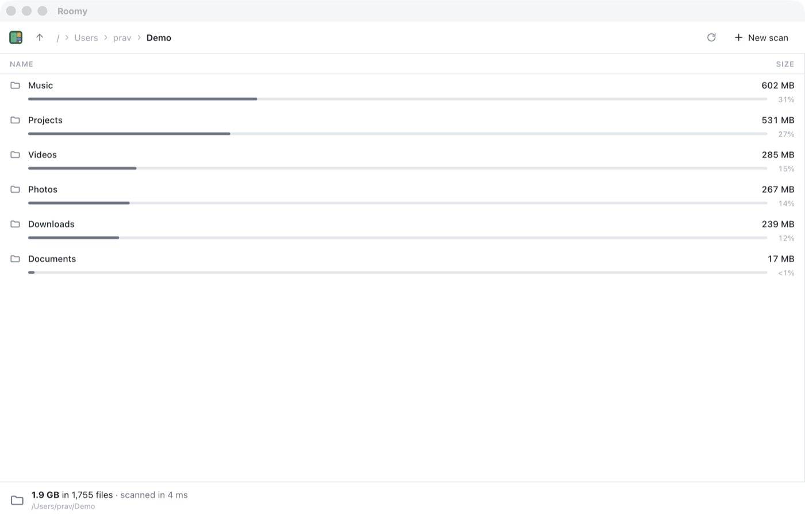

# Chapter 10 - The list view

[< Chapter 9: Race day](../09-race-day/README.md)

Since chapter 5 the app has finished every scan with the same page: a big number, and the fifteen biggest things in the folder you picked. You can't go any further in. If the biggest thing in your home folder is `Library`, well, good luck finding out what's in `Library`.

This is Part 3, where Roomy starts to look like an app. In this chapter the results become a proper screen: a toolbar with a trail of breadcrumbs, a list you can click and double-click your way down, and a bar along the bottom that tells you about whatever you've picked. Next chapter a treemap moves into the empty space beside the list.

There's very little Rust in this chapter. The tree we built in chapter 5 already knows everything the screen needs. That's the reward for building it properly.

In this chapter you will

- send a node's ancestors to the window, to make breadcrumbs,
- browse up and down the tree, with the mouse and with Backspace,
- build the list with a tiny `h()` helper instead of a framework,
- see why file names must go in as text and never as HTML,
- show the scan's time and error count in a details bar.

## Before we begin

- `app/src-tauri/src/commands.rs`: `FolderView` gains `ancestors`.
- `app/src/api.ts`: the same field, on the TypeScript side.
- `app/src/browse.ts` is new. It draws the breadcrumbs, the list and the details bar.
- `app/src/main.ts` hands the results over to `browse.ts`, and adds the toolbar buttons and the Backspace key.
- `app/index.html`: the results section is now a toolbar, a list and a footer.

The core and the command line tool don't change at all.

```text
cd chapters/10-the-list-view/app
npm install
npm run tauri dev
```

Scan a folder. You land on a list of what's in it, biggest first, each with a bar showing its share. Click a row to pick it, and the bar at the bottom describes it. Double-click a folder to go inside. The breadcrumbs at the top take you back to any folder on the way, and so do the up arrow and Backspace. The dimmed folders in front of them are the ones above the folder you scanned: click one to scan it instead. At the top of a scan, the up arrow does the same for the folder one level up. On the right of the toolbar, the circular arrow scans the same folder again, and **New scan** takes you back to the start screen to pick another.



## Breaking it up

### Ancestors

For breadcrumbs, the window needs the chain of folders from the one you scanned down to the one you're looking at. In chapter 5 we gave the tree an `ancestors` method so it could rebuild paths. Here it is again.

```text
127      pub fn ancestors(&self, id: NodeId) -> Vec<NodeId> {
128          let mut chain = vec![id];
129          let mut current = id;
130          while let Some(parent) = self[current].parent {
131              chain.push(parent);
132              current = parent;
133          }
134          chain.reverse();
135          chain
136      }
```

It climbs from the node to the root, one `parent` at a time. `while let` [line 130] is a loop that keeps going for as long as the pattern matches, so it stops at the root, whose `parent` is `None`. We collect the chain backwards, so `reverse` [line 134] turns it round.

This is the method a tree of owned, nested `Entry`s couldn't have, because a child had no way to find its parent. Chapter 5's arena is paying for itself.

Now `FolderView` sends the chain along.

```text
140  #[derive(Serialize)]
141  pub struct FolderView {
142      node: NodeView,
143      path: PathBuf,
144      /// From the scanned folder down to this one.
145      ancestors: Vec<NodeView>,
146      children: Vec<NodeView>,
147  }
```

```text
159              ancestors: tree
160                  .ancestors(id)
161                  .into_iter()
162                  .map(|a| NodeView::new(tree, a))
163                  .collect(),
```

`into_iter()` [line 161] takes the `Vec<NodeId>` and hands out its items by value. That's fine, because we're done with the `Vec`, and a `NodeId` is a small `Copy` number anyway. Each one becomes a `NodeView`, and `collect()` builds the new `Vec`. Rust works out what kind of collection to build from the field's type, `Vec<NodeView>`.

The chain includes the folder itself, last. So `ancestors[0]` is always the folder you scanned, and `ancestors[length - 1]` is the one on screen.

### One command, many folders

Notice what we didn't add: a new command. `folder` already took an optional id. Leave it out and you get the folder you scanned. Give it an id and you get that folder. Everything in this chapter, clicking, breadcrumbs, going up, is the window calling `folder` with a different number.

Each call only sends one folder's worth: the folder, its ancestors and its children. Even if the scan found two million files, a click sends a few hundred `NodeView`s at most. The whole tree stays in Rust, behind the `RwLock`, and the window asks for the part it needs.

### A tiny helper instead of a framework

Building the screen means making a lot of HTML elements. There are good frameworks for this, like React, Svelte and Vue. Each of them brings a build step, its own way of thinking, and a fair amount of JavaScript. We have one list, a row of breadcrumbs and a bar. So Roomy uses a nine-line helper instead, in `dom.ts`.

```text
 5  // Makes an element. `h("p", { class: "note" }, "Hello")` is <p class="note">Hello</p>.
 6  // Text always goes in as text, never as HTML, so a file called
 7  // "<script>.txt" can't do anything nasty.
 8  export function h<K extends keyof HTMLElementTagNameMap>(
 9    tag: K,
10    props: Record<string, unknown> = {},
11    ...children: Child[]
12  ): HTMLElementTagNameMap[K] {
```

`h` takes a tag name, some properties and any number of children, and returns the element. The name comes from "hyperscript", an old idea that many frameworks still use under the hood.

The properties are handled one at a time. Anything starting with `on` that's a function becomes an event listener [line 16], so `onclick: () => ...` does what you'd expect. `class` sets the class [line 18]. A `style` object is copied into the element's style [line 20]. Anything else becomes an attribute. And `null`, `undefined` or `false` are skipped [line 15], which lets you write `title: something ? "..." : null` without an `if`.

The children are where the safety is.

```text
28    for (const child of children) {
29      if (child === null || child === undefined || child === false) continue;
30      el.append(child);
31    }
```

`append` [line 30] adds a string as a *text node*. Whatever is in the string, the browser shows those characters. It never reads them as HTML.

This matters more than it looks. Roomy shows file names, and file names can contain almost anything. On Linux and macOS a file can be called ``. If we built the list by gluing strings into `innerHTML`, that file name would become a real image tag, and its `onerror` would run. That's a script running inside our app, chosen by whoever named a file on your disk. With `append`, it's just a strangely named file. The rule in this codebase is simple: nothing from the disk ever goes near `innerHTML`.

### The list

Here's one row.

```text
127      return h(
128        "div",
129        {
130          class: `row${child.hasChildren ? " folder" : ""}`,
131          "data-id": child.id,
132          title: child.unreadable ? "Roomy wasn't allowed to look inside this folder" : child.name,
133          onclick: () => pick(child),
134          ondblclick: () => open(child),
135        },
136        h("span", { class: "kind", style: { color: colourOf(child) } }, icon(child.kind === "dir" ? "folder" : "file")),
137        h(
138          "span",
139          { class: "name" },
140          child.unreadable ? h("span", { class: "warn" }, icon("warning", 12)) : null,
141          child.name,
142        ),
143        h("span", { class: "size" }, formatSize(child.size)),
144        h(
145          "div",
146          { class: "share" },
147          h("div", { class: "bar" }, h("div", { style: { width: `${share}%`, background: colourOf(child) } })),
148          h("span", {}, percent(child.size, total)),
149        ),
150      );
```

Reading it from the top: a `div` with the class `row`, plus `folder` for folders, so the stylesheet can make their names a little bolder. A `data-id` attribute [line 131] remembers which node the row is for, so we can find the row again later. A click picks it, a double click opens it. Then four children: an icon, the name, the size, and a bar with a percentage.

Folders we couldn't read get a small warning icon [line 140] and a tooltip saying why. Those come from the `unreadable` flag the scanner has set since chapter 5.

The bar's width is the child's share of the folder, as a percentage [line 147]. Because children are sorted biggest first, the bars shrink as you go down the list, and you can see at a glance where the space is.

`icon()` comes from `icons.ts`, which has been in the project since chapter 4 for the buttons. Each icon is one SVG path, drawn on a 24 by 24 grid with the current text colour, so `style: { color: ... }` [line 136] colours it.

### Picking and opening

There's always at most one thing picked.

```text
167  function pick(item: Picked | null) {
168    picked = item;
169    for (const row of document.querySelectorAll<HTMLElement>("#list .row")) {
170      const on = Number(row.dataset.id) === item?.id;
171      row.classList.toggle("selected", on);
172      if (on) row.scrollIntoView({ block: "nearest" });
173    }
174    renderDetails();
175  }
```

`row.dataset.id` [line 170] reads the `data-id` attribute back. Attributes are always strings, so `Number` turns it into a number to compare. `item?.id` is `undefined` when nothing is picked, which never equals a number, so every row is unselected. `classList.toggle` with a second argument adds the class if it's `true` and removes it if it's `false`.

`Picked` is an interface with just the fields this file needs [lines 10 to 15]. TypeScript checks shapes, not names, so a `NodeView`, which has those fields and more, can be passed in as a `Picked`. That will matter in two chapters' time, when clicks start coming from the treemap too.

Opening is even shorter.

```text
163  function open(item: Picked) {
164    if (item.hasChildren) showFolder(item.id);
165  }
```

Double-clicking a file does nothing yet. In chapter 14 it'll open the file in whatever app usually opens it.

### Breadcrumbs and going up

My first go at breadcrumbs was one button per folder, from the one you scanned down to the one you're in. It looked right and behaved badly. The last button was the folder you were already in, so clicking it did nothing. And at the top of the scan, the up arrow was greyed out, so it looked broken too. The first time I used it for real, I clicked both, and nothing happened either time. If something looks like a button, it should do something.

So the path is now in two halves. The folders *above* the one you scanned are dimmed, and clicking one starts a new scan there. The folders *inside* the scan are buttons that take you back to them. The one you're in is plain bold text. For a scan of `/Users/prav/Code`, looking inside `games`, the toolbar reads

```text
/ › Users › prav › Code › games
```

with `/`, `Users` and `prav` dimmed, `Code` a button, and `games` just text.

#### The folders above the scan

The tree only knows about what we scanned. Everything above it, we work out from the path.

```text
66  // The folders above the one that was scanned, from the top of the disk
67  // down. For /Users/me/Code that's /, /Users and /Users/me.
68  function outside(root: string): { name: string; path: string }[] {
69    const windows = root.includes("\\");
70    const sep = windows ? "\\" : "/";
71    const parts = root.split(sep).filter(Boolean);
72    if (parts.length === 0) return []; // The top of the disk
73    const chain: { name: string; path: string }[] = [];
74    let path = windows ? "" : "/";
75    if (!windows) chain.push({ name: "/", path });
76    for (const part of parts.slice(0, -1)) {
77      path = windows && path === "" ? `${part}${sep}` : path.endsWith(sep) ? path + part : path + sep + part;
78      chain.push({ name: part, path });
79    }
80    return chain;
81  }
```

The root node's name is its whole path, because that's how the scanner named it back in chapter 5. We split it into parts [line 71]. `filter(Boolean)` throws away the empty strings that a leading `/` or a trailing `\` leave behind. Then we build the path back up one part at a time [lines 76 to 79], remembering each folder on the way. `slice(0, -1)` leaves out the last part, because that's the folder we scanned, and it gets a breadcrumb of its own.

Windows paths look different. `C:\Users\me\Code` uses backslashes and starts with a drive letter, not `/`. A backslash in the path tells us which kind we have [line 69]. On Windows the first part, `C:`, becomes `C:\` [line 77], because `C:` on its own means "wherever you were last on drive C", which is a strange old DOS habit. On macOS and Linux the chain starts at `/` [line 75].

If you scanned the very top of a disk, there's nothing above it [line 72], and the function says so with an empty list.

The `{ name: string; path: string }[]` is TypeScript for "a list of objects, each with a `name` and a `path`". TypeScript checks that every object we push has both.

#### Drawing them

```text
 87  function renderCrumbs() {
 88    const crumbs = $("#crumbs");
 89    const ancestors = current!.ancestors;
 90    const above = outside(ancestors[0].name);
 91    const sep = () => h("span", { class: "sep" }, icon("chevron", 12));
 92    crumbs.replaceChildren();
 93
 94    // Folders above the scan are dimmed. Clicking one scans it.
 95    for (const folder of above) {
 96      crumbs.append(
 97        h("button", { class: "outside", title: `Scan ${folder.path}`, onclick: () => scanFolder(folder.path) }, folder.name),
 98        sep(),
 99      );
100    }
101    // Folders inside the scan. The last one is where we are, so it isn't a button.
102    ancestors.forEach((a, i) => {
103      const name = i === 0 ? lastPart(a.name) : a.name;
104      if (i > 0) crumbs.append(sep());
105      if (i === ancestors.length - 1) {
106        crumbs.append(h("span", { class: "here", title: current!.path }, name));
107      } else {
108        crumbs.append(h("button", { title: a.name, onclick: () => showFolder(a.id) }, name));
109      }
110    });
111
112    const up = $("#up") as HTMLButtonElement;
113    up.disabled = ancestors.length < 2 && above.length === 0;
114    up.title = ancestors.length >= 2 ? "Up one folder (Backspace)" : "Scan the enclosing folder";
115  }
```

The `!` in `current!` tells TypeScript "I know this isn't null here". We only call `renderCrumbs` after `current` has been set. `sep` [line 91] is a little function rather than a single element, because an element can only be in one place on the page. Append the same one twice and it just moves. So each chevron is made fresh.

The dimmed folders come first [lines 95 to 100]. Their tooltip says "Scan /Users/prav", so nobody is surprised when a scan starts. The `outside` class makes them faint in `style.css`.

Then the folders inside the scan [lines 102 to 110]. The scanned folder's name is its whole path, so we show only the last part of it [line 103]. The full path is already spelled out by the dimmed folders in front of it. Every folder except the last gets a button. The last one, where you are now, is a `span` [line 106]. A button that does nothing is worse than no button, because it looks like it should work. A plain bit of bold text doesn't promise anything. Hover over it and its tooltip still shows the full path.

The up arrow [lines 112 to 114] is greyed out only when there's truly nowhere to go: you're at the top of the scan *and* the top of the disk. Its tooltip changes to say what it will do.

#### Going up, or further

```text
54  // Goes up one folder. At the top of the scan there's nothing above us in
55  // the tree, so with `orScan` we scan the enclosing folder instead.
56  export function goUp(orScan = false) {
57    if (!current) return;
58    if (current.ancestors.length >= 2) {
59      showFolder(current.ancestors[current.ancestors.length - 2].id);
60    } else if (orScan) {
61      const above = outside(current.ancestors[0].name);
62      if (above.length > 0) scanFolder(above[above.length - 1].path);
63    }
64  }
```

Inside the scan, going up is just showing the second-to-last ancestor [line 59]. At the top, if we've been allowed to [line 60], we scan the folder that holds this one, which is the last entry in `outside` [line 62]. `orScan = false` is a default value. Call `goUp()` and `orScan` is `false`. Call `goUp(true)` and it's `true`.

Why make scanning optional? Because of the keyboard.

```text
71  document.addEventListener("keydown", (e) => {
72    if ($("#results").hidden) return;
73    if (e.key === "Backspace" || (e.key === "ArrowUp" && (e.metaKey || e.altKey))) goUp();
74  });
```

Backspace goes up, like it did in old file managers. So do Cmd+Up on a Mac and Alt+Up on Windows and Linux, like they do in Finder and Explorer. We ignore the keys unless the results are on screen [line 72], so Backspace on the start screen does nothing. Here `goUp()` never scans. It's easy to tap Backspace one time too many, and a stray key press shouldn't throw away your results and start a scan of your whole home folder. Clicking the up arrow is a deliberate act, so the button calls `goUp(true)`.

```text
67  $("#up").onclick = () => goUp(true);
```

#### Starting a scan from browse.ts

There's one snag. The `scan` function lives in `main.ts`, and `main.ts` already imports from `browse.ts`. If `browse.ts` imported `scan` back from `main.ts`, the two files would import each other, which works in JavaScript but is a good way to get confused about what has loaded when. So `browse.ts` keeps a slot for it instead.

```text
47  // Starts a new scan. main.ts hands us its `scan` function, because the
48  // breadcrumbs and the up button can ask for one.
49  let scanFolder: (path: string) => void = () => {};
50  export function setScanner(scan: (path: string) => void) {
51    scanFolder = scan;
52  }
```

`(path: string) => void` is the type of a function that takes a string and returns nothing. It starts out as a function that does nothing [line 49], and `main.ts` fills it in when it starts up.

```text
60  setScanner(scan);
```

Functions in JavaScript are values like any other, so handing one over is no different from handing over a number. Rust can do this too, as you saw with the closures in chapter 6.

### The details bar

When nothing is picked, the bar at the bottom describes the folder on screen, and the scan that found it.

```text
190          h("strong", {}, formatSize(folder.size)),
191          ` in ${formatCount(folder.files)} files`,
192          lastScan ? h("span", { class: "muted" }, ` · scanned in ${formatSeconds(lastScan.seconds)}`) : null,
193          lastScan && lastScan.errors > 0
194            ? h("span", { class: "muted" }, ` · ${formatCount(lastScan.errors)} couldn't be read`)
195            : null,
```

That's where the scan time from chapter 6 and the error count from chapter 7 live now: "23 GB in 484,111 files · scanned in 2.5 s". `main.ts` passes the scan's summary to `setScan` when it arrives, and `browse.ts` keeps it in `lastScan` [line 19].

When something is picked, the bar shows its name, its size, its share of the folder, and its full path. The path is the folder's path with the name added on the end.

```text
158  function join(folder: string, name: string): string {
159    const sep = folder.includes("\\") ? "\\" : "/";
160    return folder.endsWith(sep) ? folder + name : folder + sep + name;
161  }
```

That's a quick guess at the separator: Windows paths have backslashes, everyone else's don't. It only builds a string for people to read. Anything that touches the disk gets its path from Rust, which knows for certain.

## Adding functionality

Let's make Enter open whatever is picked, so you can browse with the keyboard.

1. In `browse.ts`, export a new function:

   ```text
   export function openPicked() {
     if (picked) open(picked);
   }
   ```

2. In `main.ts`, import `openPicked` from `./browse`.
3. In the `keydown` listener, add `if (e.key === "Enter") openPicked();`.

Click a folder, press Enter, and you're in it.

## Exercise

Make the up and down arrow keys move the pick through the list, so you can browse without the mouse at all. The list should scroll to keep the picked row in view.

*Hint: `browse.ts` has `current.children` in order. Find the index of the picked one with `findIndex`, add or subtract one, and call `pick` with that child. `pick` already scrolls the row into view. Remember to call `e.preventDefault()`, or the arrow keys will scroll the list as well.*

## That's it

You can find anything now, one folder at a time. But a list only shows one folder at a time, and big things hide in deep places. Next chapter we start on the treemap, which shows everything at once, beginning with the algorithm that decides where every box goes.

[Chapter 11: Squarified treemaps](../11-squarified-treemaps/README.md)
