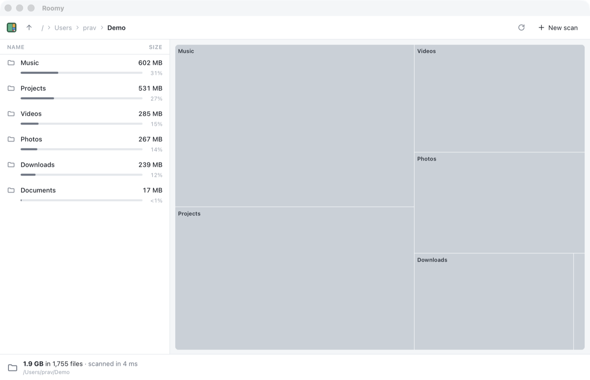

# Chapter 11 - Squarified treemaps

[< Chapter 10: The list view](../10-the-list-view/README.md)

A list is honest, but it's slow to read. You have to look at every row and compare the numbers in your head. A treemap shows the same information as a picture. Every file and folder gets a box, and the bigger the thing, the bigger the box. You can see at a glance that one folder is half the disk.

There are lots of ways to cut a rectangle into boxes of given sizes. Most of them make long, thin slivers that are hard to see and harder to click. In this chapter we write the one everyone uses, the *squarified* treemap, which keeps the boxes as close to square as it can.

In this chapter you will

- write the squarified treemap algorithm in the core crate,
- work through it by hand on the example from the original paper,
- meet slices, `f64` and testing with a tolerance,
- add a `treemap` command, and paint its boxes on a `<canvas>`,
- make the canvas sharp on high DPI screens.

## Before we begin

One new Rust file, `core/src/treemap.rs`, and one new TypeScript file, `app/src/treemap.ts`. `commands.rs` gets a `treemap` command, `api.ts` gets the `Tile` type to match, and `browse.ts` creates the treemap and shows each folder in it. `index.html` gets a canvas to the right of the list.

Run it as usual.

```text
cd chapters/11-squarified-treemaps/app
npm install
npm run tauri dev
```

Pick a folder. The list is on the left as before, and on the right is a box for everything in the folder. Folders are grey and files are blue. Click a folder in the list, or a crumb at the top, and the boxes change with it. Make the window bigger and smaller and watch the boxes rearrange themselves.

The tests for the algorithm run without a window.

```text
cargo test -p roomy-core
```



## The idea

The algorithm comes from a 1999 paper by Mark Bruls, Kees Huizing and Jarke J. van Wijk, *Squarified Treemaps*. It's short and readable, if you like that sort of thing. Here is the whole idea in four sentences.

Take the sizes biggest first. Lay them in a row along the *short* side of the space you have left. Keep adding the next size to the row for as long as that makes the worst box in the row more square. When adding one more would make things worse, fix the row in place and start a new row in the space that's left.

"More square" needs a number. For a box `w` wide and `h` tall, the *aspect ratio* is the bigger of `w/h` and `h/w`. A perfect square scores 1. A box twice as long as it is wide scores 2. Lower is better. The *worst* box in a row is the one with the highest score.

## Working it through

The paper's example lays out seven sizes, 6, 6, 4, 3, 2, 2 and 1, in a rectangle 6 wide and 4 tall. They add up to 24, and so does the rectangle's area, so each size is already an area. Let's do it by hand. You'll want to have done this once before reading the code.

The rectangle is wider than tall, so the short side is the height, 4. Rows go down the left hand side as columns.

| Row tried | Column width (sum ÷ 4) | Boxes | Worst ratio | Keep going? |
|---|---|---|---|---|
| 6 | 1.5 | 1.5 × 4 | 2.67 | yes |
| 6, 6 | 3 | 3 × 2, 3 × 2 | 1.5 | yes, better |
| 6, 6, 4 | 4 | 4 × 1.5, 4 × 1.5, 4 × 1 | 4 | no, worse |

So the first row is the two sixes, a column 3 wide, each box 3 × 2. That's exactly what the paper gets, and it's what our test checks. What's left is a space 3 wide and 4 tall on the right.

Now the space is taller than wide. The short side is 3, along the top.

| Row tried | Row height (sum ÷ 3) | Worst ratio | Keep going? |
|---|---|---|---|
| 4 | 1.33 | 2.25 | yes |
| 4, 3 | 2.33 | 1.82 | yes, better |
| 4, 3, 2 | 3 | 4.5 | no, worse |

Four and three go in a row 2.33 tall across the top. That leaves a space 3 wide and 1.67 tall, which is wider than tall again, so the twos go in columns down its left side, and the one fills the last corner. Every box keeps its area, the boxes fill the rectangle exactly, and none of them is a sliver.

The algorithm doesn't promise the best possible layout. Finding that is much too slow. It's a *greedy* algorithm: it makes the choice that looks best at each step and never goes back. It turns out to be very good, and it runs in no time at all.

## Breaking it up

### Rectangles

```text
10  #[derive(Clone, Copy, Debug, PartialEq, Serialize)]
11  pub struct Rect {
12      pub x: f64,
13      pub y: f64,
14      pub w: f64,
15      pub h: f64,
16  }
```

`f64` is a 64 bit floating point number, the same as a JavaScript `number`. We need fractions here. A box might be 1.714 pixels wide, and if we rounded every box to whole pixels the errors would add up across a row.

`Copy` [line 10] is new. Most Rust values *move* when you assign them: `let b = a;` and `a` can't be used any more. A type that is `Copy` is duplicated instead, the way numbers are. Four `f64`s are cheap to copy, so it makes `Rect` much more pleasant to pass around. You can only derive `Copy` if everything inside is `Copy` too, which rules out anything holding a `String` or a `Vec`.

`PartialEq` lets us compare two `Rect`s with `==`, which the tests need. It's *partial* because floating point numbers have `NaN`, which isn't equal to anything, not even itself.

### squarify

```text
30  pub fn squarify(sizes: &[f64], rect: Rect) -> Vec<Rect> {
31      let total: f64 = sizes.iter().sum();
32      if sizes.is_empty() || total <= 0.0 || rect.area() <= 0.0 {
33          return vec![Rect::new(rect.x, rect.y, 0.0, 0.0); sizes.len()];
34      }
35
36      // Turn sizes into areas, in the same units as the rectangle.
37      let scale = rect.area() / total;
38      let areas: Vec<f64> = sizes.iter().map(|s| s * scale).collect();
```

`&[f64]` is a *slice*: a borrowed view of some `f64`s that sit next to each other in memory. It could be a whole `Vec<f64>`, an array, or just part of one. The function doesn't care where the numbers live, only that it can read them. Taking a slice instead of `&Vec<f64>` is the Rust habit, because it accepts more things.

If there's nothing to lay out [line 32], we hand back one empty box per size, so the caller always gets as many boxes as it asked for. `vec![value; n]` makes a `Vec` with `n` copies of `value`, which works because `Rect` is `Copy`.

Then we turn sizes in bytes into areas in pixels [lines 37 and 38], so the rest of the code only has to think about one kind of number.

```text
40      let mut out = Vec::with_capacity(areas.len());
41      let mut free = rect;
42      let mut start = 0;
43      while start < areas.len() {
44          // Lay a row along the short side of whatever space is left. Keep
45          // adding boxes to the row for as long as that makes the worst box
46          // in it more square, not less.
47          let side = free.w.min(free.h);
48          let mut end = start + 1;
49          let mut sum = areas[start];
50          let mut current = worst(&areas[start..end], sum, side);
51          while end < areas.len() {
52              let next_sum = sum + areas[end];
53              let next = worst(&areas[start..=end], next_sum, side);
54              if next > current {
55                  break;
56              }
57              sum = next_sum;
58              current = next;
59              end += 1;
60          }
61          free = lay_row(&areas[start..end], sum, free, &mut out);
62          start = end;
63      }
64      out
65  }
```

This is the table from above, as code. `free` is the space that's left. `start..end` is the row we are building. `&areas[start..end]` [line 50] is a slice of just that row, with nothing copied. `start..=end` [line 53], with the `=`, includes `end` too, so it's the row with one more box in it.

We keep growing the row while the worst ratio doesn't get worse [line 54], then hand the row to `lay_row`, which places it and gives us back the space left over [line 61]. We start the next row where this one ended.

### The worst box in a row

```text
68  fn worst(row: &[f64], sum: f64, side: f64) -> f64 {
69      let (min, max) = row
70          .iter()
71          .fold((f64::MAX, 0.0f64), |(lo, hi), &a| (lo.min(a), hi.max(a)));
72      let (sum2, side2) = (sum * sum, side * side);
73      f64::max(side2 * max / sum2, sum2 / (side2 * min))
74  }
```

`fold` walks the row once, carrying a running value along. We start with `(f64::MAX, 0.0)` and keep the smallest and biggest area seen so far. (Rust has `.min()` and `.max()` on iterators, but not for floats, again because of `NaN`.)

Line 73 is the formula from the paper. Every box in a row has the same thickness, `sum / side`, so the most lopsided box is always either the biggest one or the smallest one. We work out both ratios and keep the worse. There's no need to look at the boxes in between.

### Placing a row

```text
77  fn lay_row(row: &[f64], sum: f64, free: Rect, out: &mut Vec<Rect>) -> Rect {
78      if free.w >= free.h {
79          // Wider than tall: the row is a column down the left hand side.
80          let thickness = sum / free.h;
81          let mut y = free.y;
82          for &area in row {
83              let h = area / thickness;
84              out.push(Rect::new(free.x, y, thickness, h));
85              y += h;
86          }
87          Rect::new(free.x + thickness, free.y, free.w - thickness, free.h)
88      } else {
```

The row's thickness is its total area divided by the length of the side it runs along [line 80]. Each box is then as long as its area divided by that thickness [line 83]. We stack them one after another, and what's left is the free space minus a strip as thick as the row [line 87]. The `else` branch is the same thing turned on its side.

`out: &mut Vec<Rect>` is a *mutable borrow*. `lay_row` may push onto the caller's `Vec`, but it doesn't own it, and the caller gets it back when the function returns.

### From folders to tiles

```text
110  pub fn layout(tree: &Tree, id: NodeId, width: f64, height: f64) -> Vec<Tile> {
111      // Children are already biggest first. Empty ones would get no area.
112      let children: Vec<NodeId> = tree[id]
113          .children
114          .iter()
115          .copied()
116          .filter(|&c| tree[c].size > 0)
117          .collect();
118      let sizes: Vec<f64> = children.iter().map(|&c| tree[c].size as f64).collect();
119      let rects = squarify(&sizes, Rect::new(0.0, 0.0, width, height));
120      children
121          .into_iter()
122          .zip(rects)
123          .map(|(id, rect)| Tile { id, rect })
124          .collect()
125  }
```

Here's where the work in chapter 5 pays off. The tree already keeps children biggest first, which is exactly the order `squarify` wants. We drop empty files [line 116], because a box with no area would make `worst` divide by zero. `as f64` [line 118] turns a `u64` into a float. It's one of the few places Rust lets you convert with `as`, and it's fine here: we lose precision only above 9 petabytes.

`zip` [line 122] walks two iterators side by side and gives back pairs, so each child gets matched with its box. This layout is flat. It only goes one level deep, so a folder is a plain grey box with no contents shown. We fix that next chapter.

### Testing floats

```text
131      fn close(a: f64, b: f64) -> bool {
132          (a - b).abs() < 1e-9
133      }
```

Floating point maths isn't exact. `0.1 + 0.2` is `0.30000000000000004`, in Rust as in JavaScript. So when the test adds up the areas of all the boxes and compares with the area of the rectangle [lines 152 and 153], it checks they are *close*, within a billionth. `the_example_from_the_paper` [line 136] can use `assert_eq!` directly, because 3 and 2 come out exactly.

### Rust lays out, TypeScript paints

The `treemap` command in `commands.rs` [lines 188 to 215] borrows the tree, calls `layout`, and turns each `Tile` into a `TileView` with the name and size the window needs. TypeScript never does any maths. It asks Rust for boxes and paints them.

```text
28    async reload() {
29      if (this.folderId === null) return;
30      const { width, height } = this.canvas.parentElement!.getBoundingClientRect();
31      if (width === 0 || height === 0) return; // Hidden, nothing to draw
32      // A canvas has its own pixel size. On a high DPI screen we make it
33      // bigger than it looks, so it isn't blurry.
34      const ratio = window.devicePixelRatio || 1;
35      this.canvas.width = Math.round(width * ratio);
36      this.canvas.height = Math.round(height * ratio);
37      this.canvas.style.width = `${width}px`;
38      this.canvas.style.height = `${height}px`;
39
40      this.tiles = await api.treemap(this.folderId, width, height);
41      this.draw(ratio);
42    }
```

A canvas is a bitmap. On a Retina screen, one CSS pixel is two real pixels across, so a canvas 800 pixels wide shown 800 CSS pixels wide gets stretched, and looks blurry. We make the bitmap `devicePixelRatio` times bigger [lines 35 and 36] and keep its size on the page the same [lines 37 and 38]. Then, in `draw`, `setTransform(ratio, ...)` scales everything we paint, so the rest of the code can keep thinking in CSS pixels.

The `ResizeObserver` [line 20] calls `reload` whenever the canvas's parent changes size, so Rust lays the boxes out again for the new shape. Asking Rust again is quick. The layout for a few hundred children takes microseconds.

## Adding functionality

Let's see how much difference "squarified" makes, by switching it off.

1. In `squarify`, change the condition on line 54 to `if true {`.
2. Run the app again.

Now every row has exactly one box in it, so the boxes are long strips that alternate between columns and rows. This is called a *slice and dice* layout, and it's what treemaps looked like before 1999. Put line 54 back.

## Exercise

Add a test that checks no box in the paper's example has a worst ratio above 3.

*Hint: Loop over the boxes `squarify` returns and work out `f64::max(r.w / r.h, r.h / r.w)` for each. Remember `close` isn't needed for a less-than.*

## That's it

We have boxes, but they're only one level deep, and they don't do anything when you point at them. Next chapter we put folders inside folders, give the map some shading, and make it answer the mouse.

[Chapter 12: Drawing the treemap](../12-drawing-the-treemap/README.md)
