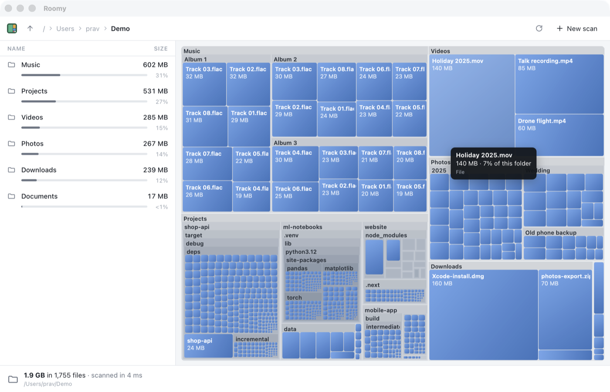

# Chapter 12 - Drawing the treemap

[< Chapter 11: Squarified treemaps](../11-squarified-treemaps/README.md)

Last chapter's treemap was one level deep. A folder was a grey box, and you had to take my word for it that there was something inside. This time folders open up to show their contents, and their contents' contents, eight levels down. We also make the map answer the mouse: point at a box and it lights up, click to pick it, double-click a folder to go inside.

In this chapter you will

- make the layout recursive, so folders hold their own little treemaps,
- meet `impl Default` and a struct of options,
- share a couple of constants between Rust and TypeScript,
- shade the boxes so they look like cushions,
- draw the map once into a hidden canvas so hovering costs nothing,
- find which box is under the mouse,
- add a tooltip.

## Before we begin

No new files this time. `core/src/treemap.rs` gets a `Layout` struct and a recursive `layout_children`. `treemap.ts` grows a lot. `browse.ts` connects the map to the list and the tooltip. `commands.rs` passes a `depth` along with each tile, and `index.html` gets a `<div>` for the tooltip.

```text
cd chapters/12-drawing-the-treemap/app
npm install
npm run tauri dev
```

Scan something with a few levels of folders. Your home folder is good. Big folders have their name across the top, and inside them are their own boxes. Files are blue with a soft highlight in the top left corner. Move the mouse over the map and a tooltip says what you're pointing at. Click a box and it gets an outline, and the list on the left picks the same thing. Double-click a folder to go inside it.



## Breaking it up

### Options, and Default

```text
115  #[derive(Clone, Copy, Debug)]
116  pub struct Layout {
117      /// How many levels of folders to show at once.
118      pub max_depth: u32,
119      /// Boxes smaller than this, in pixels, aren't worth drawing.
120      pub min_side: f64,
121      /// Space between a folder's edge and the boxes inside it.
122      pub padding: f64,
123      /// Room at the top of each folder for its name.
124      pub header: f64,
125  }
126
127  impl Default for Layout {
128      fn default() -> Layout {
129          Layout {
130              max_depth: 8,
131              min_side: 3.0,
132              padding: 1.5,
133              header: 16.0,
134          }
135      }
136  }
```

A nested treemap has knobs. How deep do we go? How small is too small? Instead of passing four numbers to every function, we put them in a struct.

`Default` is a trait from the standard library. A *trait* is a promise that a type can do something. Implementing `Default` promises "I can make a sensible value of myself with no arguments". You could derive it, but the derived version fills every field with zero, and a zero `max_depth` would draw nothing at all. So we write it by hand [lines 127 to 136]. The command asks for `&Layout::default()` [commands.rs, line 198]. If you wanted a deeper map you'd write `Layout { max_depth: 12, ..Layout::default() }`. That `..` means "the rest of the fields from this other value".

`max_depth` keeps the number of boxes under control. A folder with a million files would otherwise make a million tiny tiles, most of them smaller than a pixel. `min_side` [line 120] does the same job from the other end: a box under 3 pixels across isn't drawn, and neither is anything inside it.

### Folders inside folders

```text
153  fn layout_children(
154      tree: &Tree,
155      id: NodeId,
156      rect: Rect,
157      depth: u32,
158      options: &Layout,
159      tiles: &mut Vec<Tile>,
160  ) {
161      if depth > options.max_depth {
162          return;
163      }
```

`layout_children` lays out one folder's children in `rect`, and then calls itself for each child that is a folder. That's *recursion*, the same trick we used to walk folders in chapter 2. `depth` goes up by one each time down, and when it passes the limit [line 161] we stop.

Every call pushes onto the same `Vec`, `tiles`, borrowed mutably. That gives us one flat list of boxes, parents before their children. Remember that order, we'll lean on it in a minute.

```text
173      for (child, r) in children.into_iter().zip(squarify(&sizes, rect)) {
174          if r.w < options.min_side || r.h < options.min_side {
175              continue;
176          }
177          tiles.push(Tile {
178              id: child,
179              rect: r,
180              depth,
181          });
182          if tree[child].children.is_empty() {
183              continue;
184          }
185          // Only folders big enough to read get a name across the top. The
186          // rest keep their space for what's inside them.
187          let top = if r.w >= LABEL_WIDTH && r.h >= LABEL_HEIGHT {
188              options.header
189          } else {
190              options.padding
191          };
192          let inner = Rect::new(
193              r.x + options.padding,
194              r.y + top,
195              r.w - 2.0 * options.padding,
196              r.h - top - options.padding,
197          );
198          if inner.w >= options.min_side && inner.h >= options.min_side {
199              layout_children(tree, child, inner, depth + 1, options, tiles);
200          }
201      }
```

For each child we push its tile, and if it's a folder we shrink its box a little and lay out its own children inside [lines 192 to 199].

The folder's name needs a strip at the top. My first version gave every folder a 16 pixel header. It looked tidy for two levels, and then everything turned grey: five levels down, each folder had spent 80 pixels on headers and there was no room left for files. So now only folders big enough to label get a header [line 187]. Small ones keep a thin border and give all their space to what's inside.

`if` in Rust is an *expression*, so it has a value [lines 187 to 191]. That's why there's no `?:` operator in Rust. You don't need one.

### Sharing numbers with TypeScript

```text
111  /// A folder needs to be at least this big to have its name shown.
112  pub const LABEL_WIDTH: f64 = 64.0;
113  pub const LABEL_HEIGHT: f64 = 40.0;
```

```text
12  // These must match `header`, `LABEL_WIDTH` and `LABEL_HEIGHT` in
13  // core/src/treemap.rs, which decide which folders have room for a name.
14  const HEADER = 16;
15  const LABEL_WIDTH = 64;
16  const LABEL_HEIGHT = 40;
```

Rust decides where the header goes. TypeScript has to paint a name there. If the two disagree, names get painted over the top of files. I've written the numbers twice, with a comment on each side. A cleverer way would be to send a `labelled` flag with every tile, and that's this chapter's exercise.

### Painting once

Hovering means redrawing. Each time the mouse moves onto a new box, that box lights up and the old one goes back to normal. Painting thousands of shaded boxes on every mouse move would be slow. So we paint them once, into a canvas that is never put on the page.

```text
27    // Everything that doesn't change when the mouse moves is drawn once,
28    // here, and copied to the screen in one go.
29    private base = document.createElement("canvas");
```

`paintBase` [lines 111 to 125] draws every tile into `base`. `draw` [lines 170 to 189] copies `base` to the real canvas with a single `drawImage` [line 174], then adds the hover highlight and the selection outline on top. Copying a bitmap is about the fastest thing a canvas can do. Hovering is now nearly free, however many boxes there are.

### Cushions

```text
138    private paintFile(ctx: CanvasRenderingContext2D, t: Tile) {
139      const colour = FILE_COLOUR;
140      // A soft light from the top left gives each box a little depth, like
141      // a cushion, which makes neighbours of the same colour easy to tell apart.
142      const shade = ctx.createLinearGradient(t.x, t.y, t.x + t.w, t.y + t.h);
143      shade.addColorStop(0, mix(colour, "#ffffff", 0.22));
144      shade.addColorStop(1, mix(colour, "#000000", 0.18));
```

Two neighbouring files of the same colour with a one pixel gap between them look like one big box. A gradient from light in the top left corner to dark in the bottom right gives each box an edge. This is a cheap version of van Wijk's *cushion treemaps*, which WinDirStat made famous. `mix` [line 193] blends two colours, so the light and dark ends are always a shade of the box's own colour.

Folders get flat colours instead, slightly lighter at each level in light mode and slightly darker in dark mode (`folderColour`, [line 20]), so you can tell where one folder stops and its neighbour begins.

### Which box is under the mouse?

```text
101    // The deepest box under a point. Children come after their parents in
102    // the list, so the last match wins.
103    private hit(x: number, y: number): Tile | null {
104      for (let i = this.tiles.length - 1; i >= 0; i--) {
105        const t = this.tiles[i];
106        if (x >= t.x && x < t.x + t.w && y >= t.y && y < t.y + t.h) return t;
107      }
108      return null;
109    }
```

Here is that ordering again. A point inside a file is also inside its folder, and its folder's folder. We want the file, the deepest one. Because Rust pushed every parent before its children, the deepest match is the *last* one in the list. So we search from the end backwards and stop at the first hit. No tree walking needed.

A linear search through a few thousand rectangles takes well under a millisecond, which is less time than the mouse takes to move a pixel. I tried something cleverer and couldn't measure the difference.

### Talking back

The map doesn't know about the list or the tooltip. It has three callbacks [lines 37 to 39], `onHover`, `onSelect` and `onOpen`, and `browse.ts` fills them in.

```text
226  // The treemap talks back through these.
227  map.onSelect = (tile) => pick(tile);
228  map.onOpen = (tile) => open(tile);
```

Picking a tile calls the same `pick` the list uses, so clicking either one selects the same thing in both. The tooltip handler [lines 174 to 191] fills the tooltip in, and keeps it inside the window so it doesn't fall off the right hand edge [lines 187 and 188].

### Resizing, less often

```text
68      // Lay out again when the window changes size, but not on every pixel.
69      new ResizeObserver(() => {
70        clearTimeout(this.resizeTimer);
71        this.resizeTimer = window.setTimeout(() => this.reload(), 120);
72      }).observe(canvas.parentElement!);
```

Dragging the window's corner fires the observer dozens of times a second. Last chapter that was fine. Now each layout can be thousands of tiles, and it goes through Rust and back. So we wait until the size has stopped changing for 120 milliseconds, and lay out once. This is called *debouncing*. Every call cancels the timer the last one set [line 70].

## Adding functionality

Let's see the whole tree, all the way down.

1. In `core/src/treemap.rs`, change `max_depth: 8` to `max_depth: 30`.
2. Run the app and scan a big folder.

You'll see more detail, and if you scan your whole disk, you'll feel the map get slower to appear. Change `min_side` to `1.0` as well and it gets slower again. Put them back. Eight levels and three pixels is where I stopped noticing the difference.

## Exercise

Get rid of the copied constants. Add a `labelled: bool` field to `Tile`, set it in `layout_children`, send it through `TileView`, and use it in `paintFolder` instead of `LABEL_WIDTH` and `LABEL_HEIGHT`.

*Hint: You already have the condition on line 187. Store it in a variable before the `let top`, and push the tile after working it out.*

## That's it

The map has shape now, but all files are the same blue, and blue doesn't tell you much. Next chapter we sort files into kinds, video, photos, code and the rest, and give each kind its own colour.

[Chapter 13: File types](../13-file-types/README.md)
