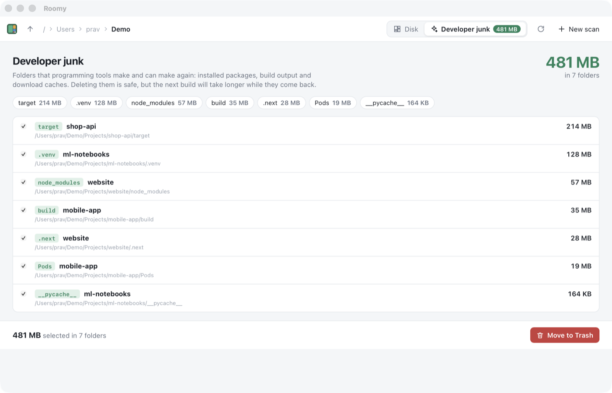

# Chapter 15 - Developer mode

[< Chapter 14: Safe delete](../14-safe-delete/README.md)

If you write software, your disk is full of copies of other people's code. Every JavaScript project has a `node_modules`. Every Rust project has a `target` folder, and they run to gigabytes. Python has `.venv`s, Xcode has DerivedData, and every package manager keeps a cache of everything it has ever downloaded. You don't need any of it until you build that project again, and then the tools make it all again on their own.

The trouble is finding it all. It's spread over hundreds of folders, and some of it is hidden. This chapter teaches Roomy to find it for you. When I pointed it at my own `~/Code` folder it found 14 GB in 109 folders.

In this chapter you will

- write a *trait*, and two types that implement it,
- keep different types in one list with *trait objects*, `Box<dyn Detector>`,
- meet `Send` and `Sync`,
- find junk without being fooled by folders that only look like it,
- add a Developer junk tab to the app, with its total on the tab,
- give the command line tool its first subcommand.

## Before we begin

One new Rust file, `core/src/junk.rs`, and one new TypeScript file, `app/src/junk.ts`. `commands.rs` gets a `junk` command. `index.html` gets a row of tabs in the toolbar and a panel for the new one, and `main.ts` switches between them. The command line tool learns `roomy junk`, and needs the `trash` crate for that.

Run the app as usual.

```text
cd chapters/15-developer-mode/app
npm install
npm run tauri dev
```

Scan a folder with some programming projects in it. As soon as the scan finishes, the *Developer junk* tab shows a green badge with the total. Click it. You get a list of every junk folder, biggest first, all ticked, with the project each belongs to. Along the top are chips for each kind: click *node_modules* to untick all of them, and again to tick them back. The bar along the bottom stays put as you scroll, showing what you've ticked and a button to move it to the Trash.



The command line does the same thing.

```text
cargo run --release -p roomy -- junk ~/Code
```

```text
Scanned /Users/prav/Code in 2.7s: 464,806 files, 19 GB

     ...
   94 KB  /Users/prav/Code/personal/games/hollowmoon-mobile/tools/art/__pycache__
   90 KB  /Users/prav/Code/partech/apps/kept/android/capacitor-cordova-android-plugins/build
   57 KB  /Users/prav/Code/partech/site/__pycache__

14 GB in 109 folders
Run again with --clean to move them to the Trash.
```

## Breaking it up

### What makes a folder junk?

Not its name. A folder called `target` might be Rust's build output, or it might be where you keep photos of targets. A folder called `build` is junk in a Gradle project and probably precious anywhere else.

What gives it away is what's next to it. Rust's `target` sits beside a `Cargo.toml`. `node_modules` sits beside a `package.json`. A Python virtual environment has a `pyvenv.cfg` *inside* it. If we insist on those, we only ever pick folders a tool made.

Caches are different. They live at known places in your home folder, like `~/.npm/_cacache` or `~/Library/Developer/Xcode/DerivedData`, so the way to spot them is the end of their path.

So that's two different ways of deciding, and there will be more. That's a job for a trait.

### The Detector trait

```text
10  /// Something that can spot one sort of junk folder.
11  pub trait Detector: Send + Sync {
12      /// A short name, like "node_modules".
13      fn name(&self) -> &str;
14      /// What the folder is and how to get it back, in one sentence.
15      fn description(&self) -> &str;
16      /// Is this folder one of ours?
17      fn matches(&self, tree: &Tree, id: NodeId) -> bool;
18  }
```

A *trait* is a list of methods a type promises to have. We've used plenty of the standard library's, like `Iterator`, `Default` and `Display`. This is our first one of our own. Anything that wants to be a `Detector` has to say what it's called, describe itself, and answer one question: is this folder one of yours?

`: Send + Sync` [line 11] means "only types that are safe to share between threads may be detectors". `Send` means a value can be moved to another thread. `Sync` means several threads can look at it at once. Rust works both out for you: a struct is `Send` and `Sync` if everything inside it is. Ours are made of `&'static str`s, so they are. We need the promise because Tauri may call our commands from any thread, and the detectors go with them.

### Next to a project file

```text
23  pub struct ProjectArtifact {
24      pub folder: &'static str,
25      /// At least one of these must sit next to the folder. Empty means no check.
26      pub next_to: &'static [&'static str],
27      /// At least one of these must be inside the folder. Empty means no check.
28      pub contains: &'static [&'static str],
29      pub description: &'static str,
30  }
```

`&'static str` is a string that lives for the whole run of the program. String literals in your code are like that: they're baked into the binary. `&'static [&'static str]` is a slice of them. Using these instead of `String` and `Vec` means the detector list costs nothing to build. No memory is allocated, it's all already in the program.

```text
41      fn matches(&self, tree: &Tree, id: NodeId) -> bool {
42          let node = &tree[id];
43          if node.kind != Kind::Dir || node.name != self.folder {
44              return false;
45          }
46          let has_child = |folder: NodeId, names: &[&str]| {
47              names.is_empty()
48                  || tree[folder]
49                      .children
50                      .iter()
51                      .any(|&c| names.iter().any(|n| tree[c].name == *n))
52          };
53          let Some(parent) = node.parent else {
54              return false; // The folder you scanned is never junk
55          };
56          has_child(parent, self.next_to) && has_child(id, self.contains)
57      }
```

The name check comes first [line 43], because it's cheap and nearly every folder fails it.

`has_child` [line 46] is a *closure*, a small function written inline that can see the variables around it, here `tree`. It asks "does this folder have a child with one of these names?". An empty list means "don't care" [line 47].

Then the real test [line 56]: is there a project file in the parent, and the right thing inside the folder? Notice we don't touch the disk. The scan already knows every name in every folder, so asking what's next to `node_modules` is a look at its parent's children. Thousands of checks take no time at all.

### At a known place

```text
77      fn matches(&self, tree: &Tree, id: NodeId) -> bool {
78          let node = &tree[id];
79          let wanted = Path::new(self.path);
80          // Building the full path is slow, so check the last part first.
81          node.kind == Kind::Dir
82              && node.parent.is_some()
83              && wanted.file_name() == Some(node.name.as_os_str())
84              && tree.path(id).ends_with(wanted)
85      }
```

`tree.path(id)` [line 84] climbs to the root and builds a `PathBuf`, which allocates. Doing that for every folder on the disk would be slow. `&&` stops at the first `false`, so we only build the path for folders that already have the right last name [line 83]. `Path::ends_with` compares whole *components*, not characters, so `.npm/_cacache` matches `/home/me/.npm/_cacache` but not `/home/me/x.npm/_cacache`.

We don't care where your home folder is. If you scan `/`, the npm cache is still `.../.npm/_cacache`.

### A list of different things

Here's the problem. We want one list of all the detectors, but they're different types, `ProjectArtifact` and `KnownCache`, and a `Vec` holds one type.

```text
89  pub fn detectors() -> Vec<Box<dyn Detector>> {
90      const JS: &[&str] = &["package.json"];
...
97      vec![
98          Box::new(ProjectArtifact {
99              folder: "node_modules",
100             next_to: JS,
101             contains: &[],
102             description: "JavaScript packages. Run `npm install` to get them back.",
103         }),
104         Box::new(ProjectArtifact {
105             folder: "target",
106             next_to: &["Cargo.toml"],
107             contains: &[],
108             description: "Rust build output. `cargo build` makes it again.",
109         }),
```

`dyn Detector` means "some type that implements `Detector`, I won't say which". That's a *trait object*. Rust can't put one directly in a `Vec`, because different types have different sizes, and each slot in a `Vec` must be the same size. A `Box` fixes that. It puts the value on the heap and keeps a pointer to it, and pointers are all the same size.

When we call `d.matches(...)` on a `Box<dyn Detector>`, Rust looks up which `matches` to run at that moment, from a little table that travels with the pointer. This is called *dynamic dispatch*. It's slightly slower than a normal call, but you'd never measure it here.

The list itself is just data. There are thirteen kinds of project folder and nine caches, from Gradle to CocoaPods to Zig. Adding your favourite tool is a few lines.

### Finding it all

```text
236  pub fn find(tree: &Tree, start: NodeId, detectors: &[Box<dyn Detector>]) -> Vec<JunkItem> {
237      let mut found = Vec::new();
238      let mut stack = vec![start];
239      while let Some(id) = stack.pop() {
240          for &child in &tree[id].children {
241              if tree[child].kind != Kind::Dir {
242                  continue;
243              }
244              match detectors.iter().find(|d| d.matches(tree, child)) {
245                  Some(detector) => found.push(JunkItem {
246                      id: child,
247                      name: detector.name().to_string(),
248                      description: detector.description().to_string(),
249                      size: tree[child].size,
250                  }),
251                  None => stack.push(child),
252              }
253          }
254      }
255      found.sort_by_key(|j| std::cmp::Reverse(j.size));
256      found
257  }
```

The same stack walk as `descendants` in chapter 13, with one difference. When a folder turns out to be junk, we note it and *don't* go inside [line 251 only pushes folders that aren't]. A `node_modules` has hundreds of `node_modules` inside it, and we don't want to list them all, or count their bytes twice. The size of a folder already includes everything in it.

### The tab

The window grows a row of tabs in the toolbar, *Disk* and *Developer junk*, and `showTab` in `main.ts` hides one panel and shows the other. Right after a scan, `main.ts` calls `loadJunk` in the background.

```text
13  export async function loadJunk(): Promise<api.JunkItem[]> {
14    const items = await api.junk();
15    const total = items.reduce((sum, i) => sum + i.size, 0);
16    const badge = $("#junk-badge");
17    badge.textContent = formatSize(total);
18    badge.hidden = items.length === 0;
19    return items;
20  }
```

So the total turns up on the tab before you think to look. Finding junk in a big scan takes a fraction of a second, because it never reads the disk.

The panel keeps the ticked folders in a `Set` [line 46]. Everything starts ticked, because people who open this tab want to clean up. The chips along the top group the folders by kind [lines 74 to 80], and clicking one ticks them all, or unticks them all if they were all ticked already [line 101]. The bar at the bottom uses `position: sticky` in the CSS, so it stays on screen however far down you scroll. Its button goes through `trashItems` from last chapter, so it asks first and uses the Trash, same as everything else.

### The command line

The command line tool gets a subcommand, `roomy junk`. clap makes it an `enum`.

```text
36  #[derive(Subcommand)]
37  enum Command {
38      /// List developer junk (node_modules, target, caches...) you can delete
39      Junk {
40          #[arg(default_value = ".")]
41          path: PathBuf,
42          /// Move everything found to the Trash
43          #[arg(long)]
44          clean: bool,
45          /// Don't ask before cleaning
46          #[arg(short, long)]
47          yes: bool,
48      },
49  }
```

Each variant is a subcommand, and its fields are that subcommand's arguments. The `///` comments become the help text: try `roomy junk --help`. `command: Option<Command>` in `Cli` [line 26] means a subcommand is optional, so plain `roomy ~/Code` still lists the biggest things, like before. `args_conflicts_with_subcommands` [line 12] stops clap mistaking `junk` for the name of a folder.

`--cross-mounts` moved into its own little struct, `ScanArgs`, with `global = true` [line 32], so it works before or after the subcommand.

```text
154      if !clean {
155          println!("Run again with --clean to move them to the Trash.");
156          return Ok(());
157      }
158      if !yes && !confirm(&format!("Move {} to the Trash?", format_size(total))) {
159          return Ok(());
160      }
```

Without `--clean`, `roomy junk` only lists. With it, it asks, unless you add `--yes` for scripts. `confirm` [line 167] reads a line from the terminal, and anything but `y` or `yes` means no. Then `trash::delete_all` moves the lot in one go.

## Adding functionality

Let's teach Roomy about .NET, which keeps its build output in `bin` and `obj` folders.

1. In `detectors()`, add a `ProjectArtifact` with `folder: "obj"`.
2. For `next_to`, .NET project files are named after the project, like `MyApp.csproj`, so a list of exact names won't do. For now use `next_to: &[]` and `contains: &["project.assets.json"]`, a file that `dotnet restore` always leaves in `obj`.
3. Scan a .NET project and check it shows up.

## Exercise

Do .NET properly: write a third detector type, `ProjectArtifactByExtension`, which matches `bin` and `obj` folders that sit next to any file ending in `.csproj` or `.fsproj`.

*Hint: Copy `ProjectArtifact`, and in `has_child` use `Path::new(&tree[c].name).extension()` instead of comparing whole names. Then add `Box::new(...)` entries for it to `detectors()`. Nothing else needs to change, which is the point of the trait.*

## That's it

Junk folders are the easy win. The sneakier waste is the same file saved in three places: the photo you downloaded twice, the installer in both `Downloads` and `Desktop`. Next chapter we find files that are byte for byte the same, without reading every byte on the disk.

[Chapter 16: Duplicates](../16-duplicates/README.md)
