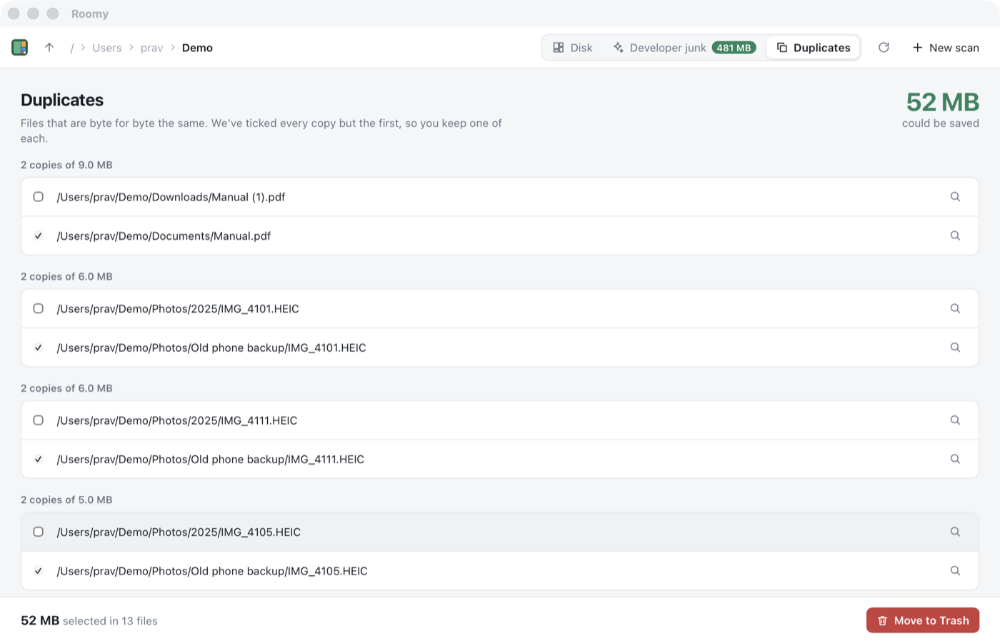

# Chapter 16 - Duplicates

[< Chapter 15: Developer mode](../15-developer-mode/README.md)

Everybody has three copies of the same holiday video. One is in Downloads, one is in Desktop/old stuff, and one is in a folder called "backup (2)" that you made in a panic in 2019. This chapter finds them.

That sounds easy: read every file, compare them. It isn't, because reading every file on a disk takes a very long time. So we'll be clever about which files we read, and how much of each.

In this chapter you will

- find duplicate files in three passes, each slower but on fewer files,
- hash files with BLAKE3,
- write a generic function with trait bounds, `refine<K, F>`,
- split work up with rayon's `into_par_iter` and `flat_map_iter`,
- learn why one call to `read` isn't always enough,
- see the `RwLock` from chapter 5 finally earn its keep,
- add `roomy dupes` to the command line tool.

## Before we begin

There's one new file, `core/src/dupes.rs`, and one new crate, `blake3`. In the app, `commands.rs` gets a `duplicates` command and `src/dupes.ts` draws a third tab. The command line tool gets a `dupes` subcommand.

Build and run as usual.

```text
cd chapters/16-duplicates/app
npm install
npm run tauri dev
```

Scan a folder you suspect is full of copies (Downloads is always a good bet) and click **Duplicates**. From the terminal:

```text
cd chapters/16-duplicates
cargo run --release -p roomy -- dupes ~/Downloads --min-size 500K
```



## Three passes

Two files are duplicates if every byte in one is the same as the byte in the same place in the other. The only way to be sure is to read them both. But most files can be ruled out without reading a thing.

1. **Size.** Two files of different sizes can't be the same. We already know every file's size from the scan, so this pass costs nothing. Most files have a size nobody else shares, and they drop out here.
2. **The first 64 KB.** Files that are the same size often differ right at the start. Photos from the same camera, for example, are all much the same size but have different pictures in them from the first few kilobytes. Reading 64 KB of a file is quick.
3. **Everything.** What's left are files that are the same size and start the same way. Now, and only now, do we read them in full.

Each pass reads more of each file, but runs on far fewer files. That's the whole trick.

## Breaking it up

### Hashing

We don't compare files byte by byte against each other. With five copies of a file, that would mean comparing every pair. Instead we put each file through a *hash function*, which turns any amount of data into a short fixed size number (32 bytes, here). The same data always gives the same hash. Different data gives a different hash, except by an astronomically unlikely accident. So files with the same hash are the same file, and we can group them with a `HashMap`, keyed by hash.

We use [BLAKE3](https://github.com/BLAKE3-team/BLAKE3), which is written with Rust in mind and is very fast. It's fast enough that on most computers the disk is the slow part, not the hashing.

### What we hand back

```text
18  /// Files that are byte for byte the same.
19  #[derive(Clone, Debug, Serialize)]
20  pub struct DuplicateGroup {
21      /// The size of one copy.
22      pub size: u64,
23      pub ids: Vec<NodeId>,
24  }
25
26  impl DuplicateGroup {
27      /// Space you'd get back by keeping only one copy.
28      pub fn wasted(&self) -> u64 {
29          self.size * (self.ids.len() as u64 - 1)
30      }
31  }
```

A group is a size and the nodes that share it. Three copies of a 1 GB file waste 2 GB, because you'd want to keep one [line 29]. A group always has at least two files in it, so the `- 1` can't go below zero.

### The plan

`find` is the three passes, written out in order.

```text
35  pub fn find(tree: &Tree, start: NodeId, min_size: u64) -> Vec<DuplicateGroup> {
36      // Pass 1: group by size. No reading needed, the scan already told us.
37      let mut by_size: HashMap<u64, Vec<NodeId>> = HashMap::new();
38      for id in tree.descendants(start) {
39          let node = &tree[id];
40          if node.kind == Kind::File && node.size >= min_size.max(1) {
41              by_size.entry(node.size).or_default().push(id);
42          }
43      }
44      let groups: Vec<Vec<NodeId>> = by_size.into_values().filter(|g| g.len() > 1).collect();
45
46      // Pass 2: the first 64 KB. Pass 3: the whole file.
47      let groups = refine(groups, |id| hash_start(&tree.path(id)).ok());
48      let groups = refine(groups, |id| hash_all(&tree.path(id)).ok());
```

Pass 1 [lines 37 to 44] walks the tree with `descendants`, from chapter 13, and drops each file into a bucket by size. `entry(...).or_default()` is a handy pattern: it gets the `Vec` for this size, making an empty one first if there isn't one yet. We only look at real files, not symbolic links, and we skip anything smaller than `min_size`. Duplicate 200 byte config files aren't worth anybody's time. The `.max(1)` also skips files of size 0, which would otherwise all match each other. They include the extra hard links from chapter 8, which we counted as 0 bytes.

Then [line 44] we throw away every bucket with only one file in it. That's usually most of them.

Passes 2 and 3 [lines 47 and 48] are the same thing with a different key: split every group by what this function says about each file, and keep the pieces with more than one file left in them. So I wrote that once, as `refine`, and called it twice.

### A generic function

```text
63  fn refine<K, F>(groups: Vec<Vec<NodeId>>, key: F) -> Vec<Vec<NodeId>>
64  where
65      K: Eq + Hash + Send,
66      F: Fn(NodeId) -> Option<K> + Sync,
67  {
```

This is our first *generic* function of our own. `K` and `F` are types we haven't picked yet. Each caller fills them in. `refine` doesn't care what the key is, as long as it can do what `refine` needs. The `where` clause lists those needs. Rust calls them *trait bounds*.

- `K: Eq + Hash` means we can compare two keys and use them in a `HashMap`. `blake3::Hash` is both.
- `K: Send` means a key can be handed from one thread to another, which rayon will do.
- `F: Fn(NodeId) -> Option<K>` means `key` is something we can call with a node, and it gives back a key or nothing. `None` means "couldn't read this file", and the file drops out.
- `F: Sync` means several threads can call `key` at the same time. Our closures only borrow the tree, which nobody changes while we're working, so they are.

Rust makes a separate copy of `refine` for each pair of types it's used with, so there's no cost to this at all. It runs exactly as fast as if I'd written it out twice.

```text
68      groups
69          .into_par_iter()
70          .flat_map_iter(|group| {
71              let keyed: Vec<(K, NodeId)> = group
72                  .par_iter()
73                  .filter_map(|&id| Some((key(id)?, id)))
74                  .collect();
75              let mut split: HashMap<K, Vec<NodeId>> = HashMap::new();
76              for (k, id) in keyed {
77                  split.entry(k).or_default().push(id);
78              }
79              split.into_values().filter(|g| g.len() > 1)
80          })
81          .collect()
```

There are two levels of parallel work here. `into_par_iter` [line 69] shares the groups out between threads. It's `into_` because it takes ownership of `groups`. We don't need the old groups once we've split them. Inside each group, `par_iter` [line 72] hashes the files at the same time too, because one group might hold a hundred copies of something. Rayon's work stealing, which we met in chapter 6, sorts out who does what.

[Line 73] is a neat use of `?`. Inside the closure, `key(id)?` means "if this is `None`, return `None` from the closure right away". So `filter_map` quietly drops any file we couldn't read.

`flat_map_iter` [line 70] is for when each item turns into *several* results. Each group becomes zero, one or more smaller groups, and `flat_map` puts them all into one long list. The `_iter` version is for when the closure returns an ordinary iterator, like the one `filter` gives us [line 79], rather than a parallel one.

### Reading a file's start

```text
84  fn hash_start(path: &Path) -> io::Result<blake3::Hash> {
85      let mut buffer = vec![0; 64 * 1024];
86      let mut file = File::open(path)?;
87      let mut filled = 0;
88      // `read` can return less than we asked for, so keep going until the
89      // buffer is full or the file runs out.
90      loop {
91          let n = file.read(&mut buffer[filled..])?;
92          if n == 0 || filled + n == buffer.len() {
93              filled += n;
94              break;
95          }
96          filled += n;
97      }
98      Ok(blake3::hash(&buffer[..filled]))
99  }
```

This is the bit people get wrong, so it's worth slowing down. `read` fills *some* of the buffer and tells you how many bytes it put in. It's allowed to stop early, for any reason it likes: the data came over a network in pieces, the operating system had part of the file in memory and part of it not, a signal arrived. Usually you get everything you asked for. Usually isn't good enough here. If one copy of a file came back in two pieces and the other in one, we'd hash different amounts of data and miss a real duplicate.

So we loop [lines 90 to 97], asking each time for the part of the buffer that's still empty (`&mut buffer[filled..]`). We stop when it's full, or when `read` returns 0, which means the end of the file. Then we hash only the part we filled [line 98]. A file smaller than 64 KB is simply hashed whole.

(The standard library has `read_exact`, which does the looping for you, but it treats a file that ends early as an error. We want "as much as there is, up to 64 KB", so we write the loop ourselves.)

```text
101  fn hash_all(path: &Path) -> io::Result<blake3::Hash> {
102      let mut hasher = blake3::Hasher::new();
103      hasher.update_reader(File::open(path)?)?;
104      Ok(hasher.finalize())
105  }
```

For the whole file we don't want a buffer the size of the file. A 40 GB video would need 40 GB of memory. A `Hasher` takes the data a piece at a time, and `update_reader` [line 103] reads the file in chunks and feeds them in, getting the looping right for us.

### The app

```text
339  pub async fn duplicates(app: AppHandle) -> Result<Vec<DuplicateView>, String> {
340      const MIN_SIZE: u64 = 1_000_000;
341      tauri::async_runtime::spawn_blocking(move || {
342          let state = app.state::<AppState>();
343          with_tree(&state, |tree| {
344              Ok(dupes::find(tree, tree.root(), MIN_SIZE)
345                  .into_iter()
346                  .take(500)
```

This command can take a while. On a big disk it might read gigabytes. So, like `scan`, it runs on a thread of its own with `spawn_blocking` [line 341], and the window gets on with things. We ignore files under 1 MB [line 340] and send back the 500 worst groups at most [line 346]. Nobody is going to go through more than that, and the window would only slow down drawing them.

### The RwLock earns its keep

Back in chapter 5 I made the tree an `RwLock` instead of a `Mutex` and said it would matter later. This is later.

`with_tree` [line 343] takes a *read* lock. With a `Mutex`, only one command at a time could look at the tree. While `duplicates` spent a minute reading files, the window couldn't open a folder, draw the treemap or do anything else that needs the tree. Every click would wait. With an `RwLock`, any number of readers can hold the lock at the same time. Only `trash`, which changes the tree, needs a write lock and has to wait its turn. So you can carry on looking around the Disk tab while the duplicates are worked out.

### The tab

`src/dupes.ts` looks a lot like the junk tab from chapter 15, with one important difference.

```text
34  // Tick every copy but the first, so one of each is always kept.
35  const ticked = new Set(groups.flatMap((g) => g.copies.slice(1).map((c) => c.id)));
```

```text
48  clean.onclick = async () => {
49    // Never let every copy in a group go.
50    for (const g of groups) {
51      if (g.copies.every((c) => ticked.has(c.id))) {
52        ticked.delete(g.copies[0].id);
53      }
54    }
```

With junk, throwing everything away is the point. With duplicates, throwing every copy away means you've lost the file. So we start with all but the first copy ticked [line 35]. Then, just before anything goes to the Trash, we check every group, and if you've ticked every copy we quietly keep the first one [lines 50 to 54]. Belt and braces. It's the Trash, so you could get it back anyway, but I'd rather you didn't have to.

### The command line

The `dupes` subcommand takes a `--min-size` like `500K` or `1G`. Clap can't turn "500K" into a number on its own, so we give it a function to do it with `value_parser = parse_size`.

```text
234  fn parse_size(text: &str) -> Result<u64, String> {
235      let text = text.trim().to_ascii_uppercase();
236      let text = text.strip_suffix('B').unwrap_or(&text);
237      let (number, unit) = match text.char_indices().find(|(_, c)| c.is_ascii_alphabetic()) {
238          Some((i, _)) => text.split_at(i),
239          None => (text, ""),
240      };
```

We upper-case it, so "10m" works too, and take off a trailing B, so "10MB" works [line 236]. Then we find the first letter and split the text there into a number and a unit [lines 237 to 240]. The number is parsed as an `f64`, so "1.5G" works. If anything is wrong, clap shows our error message next to the option's name, which is a lot friendlier than a crash.

## Adding functionality

Make the app show how long the comparison took, the way the scan does.

1. In `commands.rs`, start an `Instant` at the top of the `spawn_blocking` closure.
2. Return `(groups, seconds)` instead of just the groups, and change `DuplicateView`'s list into a struct with a `seconds` field next to `groups`.
3. Update `DuplicateGroup` in `api.ts` and the headline in `dupes.ts`.

## Exercise

The first copy in each group is the one we keep, but "first" is just the order the tree gave us. Keep the copy with the shortest path instead. It's usually the one in the most sensible place, not `backup (2)/old/stuff`.

*Hint: Sort `ids` in `find` with `sort_by_key`, using `tree.path(id).components().count()`.*

## That's it

Roomy can now find big folders, developer junk and duplicate files. That's everything it does. In the next part we stop adding features and start making it something you could give to a stranger, starting with a proper start screen and some settings.

[Chapter 17: Settings and polish](../17-settings-and-polish/README.md)
