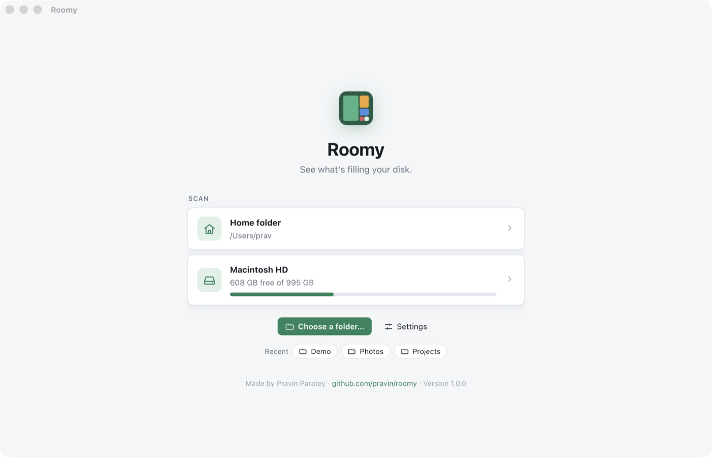

# Chapter 17 - Settings and polish

[< Chapter 16: Duplicates](../16-duplicates/README.md)

Roomy does everything it's going to do. It doesn't yet feel like something you'd download, though. You open it and get a single button. It forgets which folders you like. It has opinions about what to skip and you can't change them. And if you right-click, you can reload the page and lose your scan.

This chapter is housekeeping. None of it is hard, but it's the difference between a project and a product.

In this chapter you will

- save settings as JSON with serde, and survive a broken settings file,
- list the computer's disks with the `sysinfo` crate,
- show a real progress bar when scanning a whole disk,
- remember recent folders,
- add a settings dialog,
- let `roomy-app ~/Code` go straight to a scan,
- add a credit line that opens a link in the web browser,
- add a proper menu bar with keyboard shortcuts, and grey out what doesn't apply,
- copy a file's path to the clipboard,
- see how the app icons were made.

## Before we begin

New files: `app/src-tauri/src/settings.rs` and `app/src/start.ts`. `commands.rs` gets `places`, `launch_path`, `get_settings` and `save_settings`, and `scan` and `duplicates` read the settings now. The start screen in `index.html` gets cards for your home folder and disks, a Settings button, a recent list and a footer. There's a `<dialog>` for the settings.

There's also a menu bar: `app/src-tauri/src/menu.rs` builds it, and `app/src/menu.ts` keeps it in step with the window. `main.rs` sets it up when the app starts, and `commands.rs` gets `copy_path` and `menu_state`. The toolbar's + button is now labelled **New scan**.

Three new dependencies: `sysinfo` for the disks, the clipboard plugin, `tauri-plugin-clipboard-manager`, for Copy Path, and the JavaScript half of the opener plugin, `@tauri-apps/plugin-opener`, for the link.

```text
cd chapters/17-settings-and-polish/app
npm install
npm run tauri dev
```

You'll see your home folder and each of your disks, with how full they are. Scan something, go back with **New scan** in the toolbar or **File, Start Screen**, and it's in the Recent list. Have a look through the menus too.



## Breaking it up

### Settings, with serde

```text
 8  /// Everything the user can change, saved as JSON between runs.
 9  #[derive(Clone, Debug, Serialize, Deserialize)]
10  #[serde(default, rename_all = "camelCase")]
11  pub struct Settings {
12      pub one_file_system: bool,
13      pub exclude: Vec<PathBuf>,
14      pub min_duplicate_size: u64,
15      /// Folders scanned lately, newest first.
16      pub recent: Vec<PathBuf>,
17  }
```

We've used `Serialize` since chapter 4 to send things to the window. `Deserialize` is the other direction: turning JSON back into a Rust struct. Deriving both gets us saving and loading for free.

The `#[serde(...)]` line [line 10] changes how serde does it.

- `rename_all = "camelCase"` writes `one_file_system` as `oneFileSystem`. Rust likes snake case, JavaScript likes camel case, and this way each side gets what it expects.
- `default` means that any field missing from the JSON gets its value from `Default`. That matters more than it looks. When version 1.1 adds a new setting, everybody's old settings file won't have it. Without `default`, reading it would fail.

`Default` is a trait. Deriving it would give us `false`, an empty list and 0, which aren't the defaults we want, so we write it by hand [lines 19 to 29]. It starts from `ScanOptions::recommended()` from chapter 8, so a new user gets exactly what Roomy did before there were settings.

```text
39      pub fn remember(&mut self, path: PathBuf) {
40          self.recent.retain(|p| *p != path);
41          self.recent.insert(0, path);
42          self.recent.truncate(5);
43      }
```

Recent folders: take the folder out if it's already there [line 40], put it at the front [line 41], and keep five [line 42]. `retain` keeps the items its closure says yes to, so this is "keep everything that isn't `path`".

### Where settings live

```text
46  fn file(app: &AppHandle) -> Option<PathBuf> {
47      app.path()
48          .app_config_dir()
49          .ok()
50          .map(|dir| dir.join("settings.json"))
51  }
```

Every operating system has its own idea of where settings belong. On macOS it's `~/Library/Application Support/io.github.pravin.roomy`, on Windows `%APPDATA%\io.github.pravin.roomy`, and on Linux `~/.config/io.github.pravin.roomy`. Tauri knows all three, and `app_config_dir` [line 48] picks the right one, using the identifier from `tauri.conf.json`.

### A broken file gives defaults

```text
53  /// Reads the settings file. A missing or broken file gives the defaults,
54  /// because nobody wants an app that won't start over a settings file.
55  pub fn load(app: &AppHandle) -> Settings {
56      file(app)
57          .and_then(|path| fs::read_to_string(path).ok())
58          .and_then(|text| serde_json::from_str(&text).ok())
59          .unwrap_or_default()
60  }
```

This is a chain of `Option`s. `and_then` runs the next step only if the last one gave us something. If there's no config folder, no file, or the file isn't valid JSON, the chain ends up as `None`, and `unwrap_or_default` [line 59] gives us `Settings::default()`.

I've used apps that crash at start-up because a settings file got cut in half when the laptop's battery died. Then you have to go and find the file and delete it. Here, the worst that can happen is that your settings go back to how they started. Saving [lines 62 to 69] makes the folder first, because the first time you save it won't exist yet.

`scan` now reads the settings to get its `ScanOptions`, and saves them again afterwards with the folder added to the recent list. `duplicates` uses `min_duplicate_size` instead of the 1 MB we wrote into the code in chapter 16.

### Disks, from sysinfo

The standard library can't list disks. Every operating system does it differently, and the `sysinfo` crate has done the work for us.

```text
103  pub fn places(app: AppHandle) -> Places {
104      // If we can't list the disks, the start screen just doesn't show them.
105      let disks = sysinfo::Disks::new_with_refreshed_list()
106          .map(|disks| {
107              disks
108                  .iter()
109                  .filter(|d| {
110                      let mount = d.mount_point();
111                      d.total_space() > 1_000_000_000
112                          && !mount.starts_with("/System/Volumes")
113                          && !mount.starts_with("/boot")
114                          && !mount.starts_with("/snap")
115                  })
```

Ask sysinfo for a list of everything mounted and you get a surprising amount of it. A Mac lists half a dozen volumes under `/System/Volumes`: Preboot, VM, Update and so on, which are parts of the same disk that macOS keeps apart. Ubuntu lists every Snap package as its own little disk. None of those are things you'd want to click. So we keep disks bigger than 1 GB that aren't in any of those places [lines 109 to 115]. Your Mac's disk shows up once, as `/`.

In Cargo.toml we turn off sysinfo's default features and ask only for `disk`. Sysinfo can also list processes, networks and temperature sensors, and there's no point compiling code we won't use.

The home folder comes from `app.path().home_dir()` [line 126], and the recent list from the settings.

### A real progress bar

When you click a disk, we know how much of it is used, so we know roughly how many bytes the scan will find. That's enough for a real progress bar instead of a spinner.

```text
31          { class: "place", onclick: () => scan(disk.mount, used) },
```

The disk card passes `used` along [line 31 of `start.ts`], and the scanning screen fills the bar in as the bytes come in.

```text
61      if (expected) fill.style.width = `${Math.min((p.bytes / expected) * 100, 100)}%`;
```

It's not exact. The disk's own count includes things we don't scan, like the space used by the system's swap file, or the folders we exclude. That's why there's a `Math.min` [line 57 of `main.ts`]: the bar can't go past 100%, even when it should. For a folder we don't know how big it is until we've looked, so the bar stays hidden.

### The settings dialog

HTML has a `<dialog>` element now, and it does almost everything we need: it sits on top, dims the page behind it, closes on Escape, and remembers which button closed it. The buttons are in a `<form method="dialog">`, so clicking one closes the dialog and sets `returnValue` to that button's `value`.

```text
 98    dialog.onclose = async () => {
 99      if (dialog.returnValue !== "save") return;
100      await api.saveSettings({
101        ...settings,
102        oneFileSystem: oneFs.checked,
103        minDuplicateSize: Number(minDupe.value),
104        exclude,
105      });
106    };
```

We only save when the button was Save [line 99]. `...settings` [line 101] copies everything we didn't change, like the recent list, so it isn't lost. The excluded folders are kept in a list of their own while the dialog is open [line 68 of `start.ts`], so Cancel throws away anything you added.

### Opening Roomy on a folder

```text
94  pub fn launch_path() -> Option<PathBuf> {
95      std::env::args_os()
96          .skip(1)
97          .map(PathBuf::from)
98          .find(|path| path.is_dir())
99  }
```

If Roomy is started with a folder after its name, as in `roomy-app ~/Code`, the window scans it straight away. We skip the program's own name [line 96] and take the first argument that's a folder [line 98]. Why not just the first argument? Because macOS sometimes adds arguments of its own when it starts an app, and they are never folders.

When you're running the app with `npm run tauri dev`, the arguments pass through three programs (npm, the Tauri CLI, then Cargo) before they reach Roomy, so you need a `--` for each one to get through.

```text
npm run tauri dev -- -- -- ~/Code
```

### Saying who made it

The start screen has a footer with my name and a link to the repository. By default a link opens inside Roomy's own window, replacing Roomy, which is not what anybody wants. So we stop that and hand the address to the opener plugin, which gives it to your web browser.

```text
101  // Links open in the web browser, not inside Roomy's window.
102  $("#repo").onclick = (e) => {
103    e.preventDefault();
104    openUrl((e.currentTarget as HTMLAnchorElement).href);
105  };
```

We've used the opener plugin from Rust since chapter 14, to show files in Finder. Calling it from the web page needs permission, so the capability file gets `"opener:default"`. Remember from chapter 4 that the window can do nothing that isn't on this list. `opener:default` allows opening web links but not, say, running programs on your disk.

`getVersion()` [line 105] reads the version from `tauri.conf.json`, so the footer always shows the right one.

### No reload, please

```text
156  // The default right-click menu has Reload in it, which would lose the scan.
157  document.addEventListener("contextmenu", (e) => e.preventDefault());
```

A web view is a browser, and a browser's right-click menu has Reload and Inspect in it. Reload starts the page again from scratch, and your scan is gone. Turning the menu off is a small thing, but it's one of the things that makes Roomy feel like an app rather than a web page.

### A menu bar

Here's a confession. Up to now, once you'd scanned a folder, the only way to scan a different one was a small button in the corner of the toolbar. Plenty of people never found it and quit Roomy to start again. That's not a bug in the code, it's a bug in the design. Desktop apps have a menu bar, and that's where people look for "open something else". So Roomy gets one, and **File, Scan Folder…** (⌘O on a Mac, Ctrl+O elsewhere) works from anywhere. **File, Start Screen** (⇧⌘N) takes you back to the disks and the recent list. The toolbar button got a label as well, **New scan**, so it doesn't rely on anyone guessing what a + means.

The menu lives in a new file, `src-tauri/src/menu.rs`. Tauri builds a real native menu: on a Mac it sits at the top of the screen with every other app's, and on Windows and Linux it's a bar across the top of the window.

```text
43  pub fn build(app: &AppHandle) -> tauri::Result<(Menu<Wry>, MenuState)> {
44      // A small helper, so each item is one line below. `None` means no
45      // keyboard shortcut. "CmdOrCtrl" is ⌘ on a Mac and Ctrl elsewhere.
46      let item = |id: &str, text: &str, enabled: bool, keys: Option<&str>| {
47          MenuItem::with_id(app, id, text, enabled, keys)
48      };
```

Every item needs the same four things: an id, the text people see, whether it starts enabled, and a keyboard shortcut. `item` is a closure [lines 46 to 48], a small function written in place that can see the `app` around it, so each menu item below is one call. The id is what we'll get back when the item is clicked. The shortcuts are written like `"CmdOrCtrl+O"`. `CmdOrCtrl` is ⌘ on a Mac and Ctrl on Windows and Linux, so one string gives each platform the shortcut its people expect. `Option<&str>` means "a shortcut, or `None` for no shortcut".

```text
68      let rescan = item("rescan", "Scan Again", false, Some("CmdOrCtrl+R"))?;
69      let mut file = SubmenuBuilder::new(app, "File")
70          .item(&item(
71              "scan-folder",
72              "Scan Folder…",
73              true,
74              Some("CmdOrCtrl+O"),
75          )?)
76          .item(&item(
77              "scan-home",
78              "Scan Home Folder",
79              true,
80              Some("CmdOrCtrl+Shift+H"),
81          )?)
82          .item(&rescan)
83          .separator()
84          .item(&item(
85              "start",
86              "Start Screen",
87              true,
88              Some("CmdOrCtrl+Shift+N"),
89          )?)
90          .separator()
91          .close_window();
92      if !mac {
93          file = file
94              .separator()
95              .item(&settings)
96              .separator()
97              .quit_with_text("Exit");
98      }
```

`SubmenuBuilder` builds one menu, a call at a time. Each method hands the builder back, so the calls chain [lines 69 to 91]. `.separator()` draws a line, and `.close_window()` is a *predefined* item: Tauri already knows its text, shortcut and job on every operating system.

Notice `let mut file` and the `if !mac` [line 92]. Macs and PCs put things in different places. On a Mac, Settings and Quit live in a menu named after the app. Windows and Linux don't have one, so there they go at the bottom of File, and Quit is called Exit. `cfg!(target_os = "macos")` [line 49] is like the `#[cfg]` from chapter 8, except it's an expression that's `true` or `false`, so both branches are compiled everywhere and we can use it in an ordinary `if`.

```text
51      let about = PredefinedMenuItem::about(
52          app,
53          Some("About Roomy"),
54          Some(AboutMetadata {
55              name: Some("Roomy".into()),
56              version: Some(app.package_info().version.to_string()),
57              authors: Some(vec!["Pravin Paratey".into()]),
58              comments: Some("See what's filling your disk.".into()),
59              copyright: Some("© 2026 Pravin Paratey".into()),
60              license: Some("Apache-2.0".into()),
61              website: Some(REPO.into()),
62              website_label: Some("github.com/pravin/roomy".into()),
63              ..Default::default()
64          }),
65      )?;
```

`PredefinedMenuItem::about` makes the About box. On a Mac it's the proper system panel, with Roomy's icon, version, copyright and a link to the repository. On Windows and Linux Tauri shows its own version of the same thing. `AboutMetadata` has a lot of fields, and we fill in the ones we care about. `..Default::default()` [line 63] fills in the rest with their defaults. It's the same struct update syntax as `...settings` in TypeScript. That box is also where Roomy says who made it, which matters to me.

There's no Edit menu. On a Mac, the Edit menu is what makes ⌘C and ⌘V work in text boxes, and an app with text fields needs one. Roomy has none, and the only thing you could undo is moving something to the Trash, which you undo from the Trash.

### Greying things out

Some items only make sense some of the time. **Scan Again** needs a scan. **Move to Trash** needs something picked. A menu item that does nothing when you click it feels broken, so we grey them out instead.

```text
11  /// The items that only make sense some of the time, kept so we can grey
12  /// them out. Tauri can't look items up inside submenus, so we hold on to
13  /// them ourselves.
14  pub struct MenuState {
15      /// Need a finished scan.
16      scanned: Vec<MenuItem<Wry>>,
17      /// Need something picked in the list or the treemap.
18      picked: Vec<MenuItem<Wry>>,
19  }
20
21  impl MenuState {
22      pub fn update(&self, scanned: bool, picked: bool) {
23          for item in &self.scanned {
24              item.set_enabled(scanned).ok();
25          }
26          for item in &self.picked {
27              item.set_enabled(picked).ok();
28          }
29      }
30  }
```

To change an item later we need hold of it. Tauri's menus have a `get` method, but it only looks at the top level, not inside File or View, so we keep the items ourselves [lines 16 and 18]. `MenuItem` is cheap to keep: it's a handle to the real menu item, much like a window handle in Win32, and cloning it doesn't make a second item.

```text
182      let state = MenuState {
183          scanned: vec![rescan, view_disk, view_junk, view_dupes, go_up, go_top],
184          picked: vec![open, reveal, copy_path, trash],
185      };
186      Ok((menu, state))
```

`build` gives back the menu and the `MenuState` together, as a tuple. In `main.rs` we put the menu on the app and hand `MenuState` to Tauri to look after, just like `AppState`.

```text
29          .setup(|app| {
30              let (menu, state) = menu::build(app.handle())?;
31              app.set_menu(menu)?;
32              app.manage(state);
33              Ok(())
34          })
35          .on_menu_event(|app, event| menu::clicked(app, event.id().as_ref()))
```

`setup` runs once, when the app starts [line 29]. `app.manage(state)` [line 32] means any command can ask for `State<MenuState>`, and the `menu_state` command does exactly that.

```text
451  /// Greys out the menu items that don't make sense right now.
452  #[tauri::command]
453  pub fn menu_state(menu: State<MenuState>, scanned: bool, picked: bool) {
454      menu.update(scanned, picked);
455  }
```

The web page knows whether there's a scan and whether something is picked, so it tells Rust whenever either changes. `menu.ts` keeps both flags and sends them together.

```text
 7  const state = { scanned: false, picked: false };
 8
 9  export function setScanned(scanned: boolean) {
10    state.scanned = scanned;
11    if (!scanned) state.picked = false;
12    api.menuState(state.scanned, state.picked);
13  }
14
15  export function setPicked(picked: boolean) {
16    state.picked = picked;
17    api.menuState(state.scanned, state.picked);
18  }
19
20  // `handler` gets the id of the item that was clicked, like "scan-folder".
21  export function onMenu(handler: (id: string) => void) {
22    listen<string>("menu", (e) => handler(e.payload));
23  }
```

### Clicks

`on_menu_event` [line 35 of `main.rs`] runs for every click. It calls `clicked` in `menu.rs`.

```text
189  /// Runs when any menu item is clicked. Links open in the browser here;
190  /// everything else is the web page's job.
191  pub fn clicked(app: &AppHandle, id: &str) {
192      let link = match id {
193          "help-repo" => Some(REPO.to_string()),
194          "help-tutorial" => Some(format!("{REPO}#the-chapters")),
195          "help-issue" => Some(format!("{REPO}/issues/new")),
196          _ => None,
197      };
198      match link {
199          Some(url) => {
200              app.opener().open_url(url, None::<&str>).ok();
201          }
202          None => {
203              app.emit("menu", id).ok();
204          }
205      }
206  }
```

The Help links open in the web browser straight from Rust [line 200], with the opener plugin we met in chapter 14. Everything else goes to the page as a `menu` event, with the item's id [line 203]. The page already has all the functions it needs, so it just has to pick one.

```text
119  onMenu((id) => {
120    const results = !$("#results").hidden;
121    switch (id) {
122      case "scan-folder":
123        chooseFolder().then((path) => {
124          if (path) scan(path);
125        });
126        break;
127      case "scan-home":
128        scanHome();
129        break;
130      case "rescan":
131        if (lastPath) scan(lastPath);
132        break;
133      case "start":
134        goHome();
135        break;
136      case "settings":
137        editSettings();
138        break;
139      case "view-disk":
140      case "view-junk":
141      case "view-dupes":
142        if (results) showTab(({ "view-disk": "map", "view-junk": "junk", "view-dupes": "dupes" } as const)[id]);
143        break;
144      case "go-up":
145        if (results) goUp(true);
146        break;
147      case "go-top":
148        if (results) goTop();
149        break;
150      default:
151        // open, reveal, copy-path and trash act on what's picked.
152        if (results && !$("#tab-map").hidden) actOnPicked(id);
153    }
154  });
```

It's one big `switch` on the id. The View and Item entries check that the results screen is showing first [line 120], because a shortcut can arrive at any moment, greyed out or not. The Item menu's four entries all go to `actOnPicked` in `browse.ts`, which does the same as the buttons along the bottom of the window. **Enclosing Folder** calls `goUp(true)`, the same as the up arrow, so at the top of a scan it scans the folder above. Chapter 10 explains why Backspace doesn't.

Backspace still goes up a folder. With ⌘ or Ctrl held, though, it's **Move to Trash**, and that's the menu's job. So the keyboard handler now leaves anything with ⌘ or Ctrl alone.

```text
108  // Backspace goes up a folder. With ⌘ or Ctrl it's a menu shortcut instead.
109  document.addEventListener("keydown", (e) => {
110    if ($("#results").hidden || $("#tab-map").hidden || e.metaKey || e.ctrlKey) return;
111    if (e.key === "Backspace") goUp();
112  });
```

**Copy Path** puts the full path of the picked file on the clipboard. Web pages can only use the clipboard in some situations, so we do it from Rust with another official plugin, `tauri-plugin-clipboard-manager`.

```text
331  /// Puts the full path of a file or folder on the clipboard.
332  #[tauri::command]
333  pub fn copy_path(app: AppHandle, state: State<AppState>, id: NodeId) -> Result<(), String> {
334      let path = with_tree(&state, |tree| {
335          check(tree, id)?;
336          Ok(tree.path(id))
337      })?;
338      app.clipboard()
339          .write_text(path.to_string_lossy())
340          .map_err(|e| e.to_string())
341  }
```

`ClipboardExt` is a trait that adds `clipboard()` to `AppHandle`, the same trick as `OpenerExt`. Like the opener, Rust can use it without any permission in the capability file. Only the web page needs permissions.

### The icons

The `src-tauri/icons` folder has the icon in every size and format the three operating systems want: PNGs, an `.icns` for macOS and an `.ico` for Windows. I didn't make them by hand. I drew one SVG, `app/public/logo.svg`, a little treemap in Roomy's colours, and the Tauri CLI made the rest.

```text
npx tauri icon public/logo.svg -o src-tauri/icons
```

It also makes Android, iOS and Windows Store icons. We don't need those, so I deleted them. If you want your own icon, draw a 1024 by 1024 square and run the same command.

## Adding functionality

Add a **Clear** button to the Recent list.

1. Add a `clear_recent` command in `commands.rs` that loads the settings, empties `recent` and saves them. Register it in `main.rs`.
2. Add `clearRecent` to `api.ts`.
3. In `showPlaces`, add a small button at the end of the recent list that calls it and then `showPlaces(scan)` again.

## Exercise

Add an **Open Recent** submenu to File, listing the recent folders, so you can scan one again without going back to the start screen.

*Hint: In `menu::build`, load the settings with `settings::load(app)` and add a `SubmenuBuilder::new(app, "Open Recent")` with one item per folder. Give each an id like `recent-0`, `recent-1`, and in the `onMenu` switch, look the folder up by number. The list changes after every scan, so the submenu needs rebuilding: keep it in `MenuState`, and have the `scan` command clear it with `items()` and `remove()` and add the new ones with `append()`.*

## That's it

Roomy looks and behaves like an app. But it only runs with `npm run tauri dev` on your own computer. In the next chapter we turn it into installers you can give to other people, and find out why macOS and Windows will be suspicious of them.

[Chapter 18: Installers and signing](../18-installers-and-signing/README.md)
