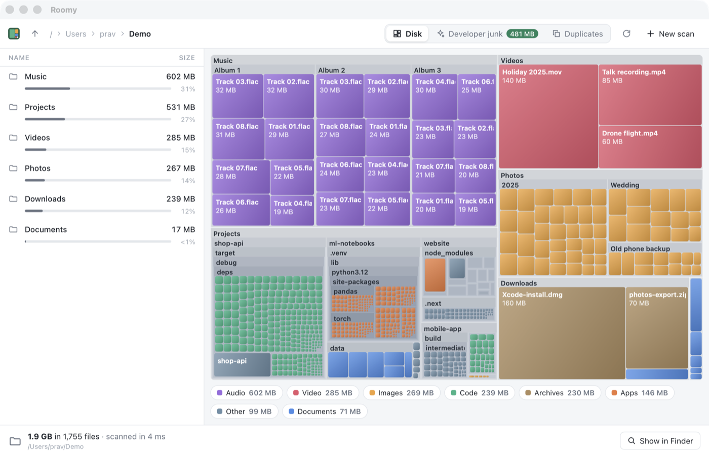

# Chapter 20 - Package managers

[< Chapter 19: Auto-update](../19-auto-update/README.md)

Roomy has installers on GitHub, and it keeps itself up to date. If you send someone a link, they can have it in a minute. But developers, which is most of the people who'll want Roomy at first, don't like going to websites to download things. They type `brew install` or `winget install` or `yay -S` and expect the thing to arrive. Every package manager Roomy is in is another place people can find it, and another place it shows up in search results.

This last chapter has no Rust in it at all. It's a tour of the recipes each package manager wants, where to send them, and the small rules each one has. They're all in the `packaging` folder.

In this chapter you will

- write a Homebrew cask and formula, and start your own tap,
- make winget manifests and send them to Microsoft,
- start a Scoop bucket,
- package Roomy for Arch Linux's AUR,
- prepare Roomy for Flathub,
- publish the core library and the command line tool to crates.io,
- tell people about it.

## Before we begin

The code is the same as chapter 19. What's new is the `packaging` folder.

```text
packaging/
  homebrew/roomy.rb                                  the app, for macOS
  homebrew/roomy-cli.rb                              the command line tool, for macOS and Linux
  winget/PravinParatey.Roomy.yaml                    the app, for Windows (three files)
  winget/PravinParatey.Roomy.installer.yaml
  winget/PravinParatey.Roomy.locale.en-GB.yaml
  scoop/roomy.json                                   the command line tool, for Windows
  aur/PKGBUILD                                       the app, for Arch Linux
  flathub/io.github.pravin.roomy.yml                 the app, for any Linux, through Flathub
  flathub/io.github.pravin.roomy.metainfo.xml
```

Every one of them points at the files the release workflow from chapter 19 uploads. So, first, make a release and publish it.

## Checksums

Every recipe has a line like `sha256 "REPLACE_WITH_SHA256"`. A SHA-256 checksum is a fingerprint of a file. The package manager downloads the file, works out its fingerprint, and refuses to install it if it doesn't match the one in the recipe. That way, if someone swapped the file on GitHub, nobody would install it.

To fill them in, download each file from your release and run

```text
shasum -a 256 Roomy_1.0.0_universal.dmg
```

on macOS or Linux, or `Get-FileHash Roomy_1.0.0_x64-setup.exe` in PowerShell. Every new version needs new checksums, which is a chore. Most package managers have a robot that does it for you once you're in, as we'll see.

## Homebrew

[Homebrew](https://brew.sh) is how most Mac developers install things. It has two kinds of recipe: a **cask** installs an app (something with a window), and a **formula** installs a command line program. Roomy is both, so we have one of each.

### The cask

```text
 4  cask "roomy" do
 5    version "1.0.0"
 6    sha256 "REPLACE_WITH_SHA256_OF_THE_DMG"
 7
 8    url "https://github.com/pravin/roomy/releases/download/v#{version}/Roomy_#{version}_universal.dmg"
```

Homebrew recipes are written in Ruby. You don't need to know any; it reads like a form. `#{version}` [line 8] puts the version into the address, so a new release only needs the `version` and `sha256` lines changed. The release workflow builds a universal `.dmg`, so one file works on every Mac.

Further down, `auto_updates true` tells Homebrew that Roomy updates itself, so `brew upgrade` doesn't fight our updater. `zap` lists the folders Roomy leaves behind, the settings folder from chapter 17 among them, so `brew uninstall --zap roomy` can remove every trace.

### The formula

```text
13    def install
14      cd "chapters/20-package-managers" do
15        system "cargo", "install", *std_cargo_args(path: "cli")
16      end
17    end
```

Homebrew prefers formulas built from source, so this one downloads the source code of the release and runs `cargo install` on the `cli` crate [line 15]. It has a `test` block too, which Homebrew runs to check the install worked: it makes a folder with one file in it and checks that Roomy says "1 files".

### Your own tap

Homebrew's main collections, homebrew/core and homebrew/cask, don't take everything. They have notability rules: roughly, a project needs a certain number of GitHub stars and forks, and for casks the app has to pass Gatekeeper, which means it must be signed and notarised (chapter 18). A brand new project won't get in.

So start with your own **tap**, which is just a GitHub repository with a name that starts `homebrew-`. Make one called `homebrew-tap`, put the cask in `Casks/roomy.rb` and the formula in `Formula/roomy-cli.rb`, and anyone can install with

```text
brew install --cask pravin/tap/roomy
brew install pravin/tap/roomy-cli
```

When Roomy is popular enough, open a pull request to homebrew/cask. After that, their robots notice new releases on GitHub and update the recipe for you.

## winget

[winget](https://learn.microsoft.com/windows/package-manager/) comes with Windows 10 and 11. Its recipes are called **manifests**, and Microsoft wants three per version.

- `PravinParatey.Roomy.yaml` says which version this is.
- `PravinParatey.Roomy.installer.yaml` says where the installer is and how to run it. `InstallerType: nullsoft` means the NSIS setup `.exe` from chapter 18, which knows how to install silently, so winget can install Roomy without asking questions.
- `PravinParatey.Roomy.locale.en-GB.yaml` is everything people read: the name, the description, the licence, the tags people might search for.

The `PackageIdentifier` is `Publisher.App`. All the manifests in the world live in one huge GitHub repository, [microsoft/winget-pkgs](https://github.com/microsoft/winget-pkgs). Fork it, put your three files in `manifests/p/PravinParatey/Roomy/1.0.0/`, and open a pull request. Robots check the files, download the installer and scan it, and someone at Microsoft merges it, usually within a few days.

There's an easier way. Microsoft's `wingetcreate` tool asks you for the installer's address, works out the checksum and most of the fields itself, and opens the pull request for you.

```text
wingetcreate new https://github.com/pravin/roomy/releases/download/v1.0.0/Roomy_1.0.0_x64-setup.exe
```

For later versions, `wingetcreate update PravinParatey.Roomy --version 1.1.0 --urls <new address> --submit` does the lot. After that, `winget install roomy` works for everyone.

## Scoop

[Scoop](https://scoop.sh) is popular with Windows developers, and it's good at command line tools. Its recipes are single JSON files, and they live in **buckets**, which are GitHub repositories, like Homebrew's taps.

Our `scoop/roomy.json` installs the command line `roomy.exe` from the release's zip file. Two parts make it look after itself: `checkver` says "the version is whatever the latest GitHub release is", and `autoupdate` says how to build the download address from a version. Scoop's robots use them to update the recipe when you release. Make a repository called `scoop-bucket`, put the file in `bucket/`, and

```text
scoop bucket add pravin https://github.com/pravin/scoop-bucket
scoop install roomy
```

## The AUR

The Arch User Repository is where Arch Linux users share recipes, called `PKGBUILD`s. Ours is a `-bin` package, which by AUR convention means it repackages a ready-made build instead of compiling one.

```text
source=("https://github.com/pravin/roomy/releases/download/v${pkgver}/Roomy_${pkgver}_amd64.deb")
...
package() {
  tar -xf data.tar.gz -C "${pkgdir}"
}
```

A `.deb` is an archive with two archives inside it: one with information about the package, and `data.tar.gz` with the files themselves. `makepkg` unpacks the outer one for us, and `package` unpacks the files into place. The `depends` line lists the Arch names for the web view and GTK, which the `.deb` would have asked Ubuntu for.

To publish it, make an account at aur.archlinux.org, add your SSH key, and push a git repository named `roomy-bin` containing the `PKGBUILD` and a `.SRCINFO`, which you make with `makepkg --printsrcinfo > .SRCINFO`. Then `yay -S roomy-bin` works.

## Flathub

[Flathub](https://flathub.org) is the app store for Flatpak, which works on almost every Linux distribution and is built into the software centres of Fedora, Ubuntu's flavours, Linux Mint and others. It's the best way to reach Linux users who aren't developers.

Flathub wants two files. `io.github.pravin.roomy.metainfo.xml` describes Roomy for software centres: its name, summary, description, licence, developer and releases. The file name, and the `id` inside it, is the identifier from chapter 18. This is where it matters: Flathub only accepts an `io.github.` identifier if it matches a GitHub account you can show is yours.

`io.github.pravin.roomy.yml` is the build recipe. Flathub builds every app on its own servers with no internet access, apart from the sources the recipe lists. Building a Rust and npm project that way means listing every crate and npm package as a separate source, which tools can generate but is a fair bit of work. Ours takes the shortcut of unpacking the `.deb` from the release. Flathub does accept apps built this way, but reviewers may ask you to build from source, so be ready for that conversation.

The most interesting part is the permissions.

```text
finish-args:
  - --socket=wayland
  - --socket=fallback-x11
  - --share=ipc
  - --device=dri
  # Roomy's whole job is looking at your files.
  - --filesystem=host
  - --talk-name=org.freedesktop.FileManager1
```

Flatpak apps run in a sandbox and see nothing of your computer unless the manifest asks. Most apps should ask for as little as possible, and reviewers question anything broad. `--filesystem=host` is about as broad as it gets: it means all your files. For a disk analyser, that's the point. A disk analyser that can only see its own folder is no use to anybody. Say so plainly in your submission. `org.freedesktop.FileManager1` lets "Show in Files" work.

To submit, fork [flathub/flathub](https://github.com/flathub/flathub), add your manifest on a new branch, and open a pull request. A reviewer will go through it with you. Once it's merged you get a repository of your own under the Flathub organisation, and from then on you update Roomy there.

## crates.io

Rust developers have their own package manager already: Cargo. Anything on [crates.io](https://crates.io) installs with `cargo install`. We publish two crates. `roomy-core` is the library, which anybody could use to build their own disk tool, and `roomy` is the command line tool that depends on it. Both names were free when I checked.

Make an account at crates.io by signing in with GitHub, make an API token, and give it to Cargo with `cargo login`. Then publish, library first. crates.io won't accept `roomy` until the `roomy-core` it depends on is there.

```text
cargo publish -p roomy-core
cargo publish -p roomy
```

One thing to check first. Inside the workspace, the CLI finds `roomy-core` by its `path`. crates.io has no idea what's on your disk, so a published crate needs a `version` for each dependency as well. That's why the `roomy-core` line under `[workspace.dependencies]` in the top `Cargo.toml` has both, `path = "core"` and `version = "1.0.0"`. Cargo uses the path while you work and the version when it publishes. Remember to change that version along with the workspace's own when you release 1.1. `cargo publish --dry-run -p roomy` will tell you if anything else is missing.

A published version can't be changed or deleted, only *yanked*, which hides it from new installs. Get the description and licence right first. After that, anyone can type

```text
cargo install roomy
```

## The licence

Every one of these manifests asks for a licence, and they all want the same short name: `Apache-2.0`. That's an SPDX identifier, a standard list of licence names that crates.io, Homebrew, winget, Scoop, the AUR and Flathub all understand, so they can show it and filter by it. It's in the top `Cargo.toml` as `license = "Apache-2.0"`, which both crates pick up, and in each file in `packaging/`. If you change licence, change it everywhere at once.

I picked the Apache License 2.0 because it lets anyone use Roomy's code, even in closed source programs, but asks for credit in return. Anybody who passes the code on has to keep the `NOTICE` file at the top of the repository with it, and that file says who made Roomy and where it lives. MIT and BSD keep a copyright line too, but Apache's NOTICE is harder to lose, and Apache also includes a patent grant, which makes companies comfortable using it. The tutorial's text is a separate thing, under CC BY 4.0.

## Telling people

Now everybody can install Roomy. Nobody knows it exists. A few places that are kind to new open source tools:

- **Show HN**, on Hacker News. Post the GitHub link with a title like "Show HN: Roomy, a fast disk space analyser that finds developer junk". Be around to answer questions for the first few hours. Talk about what you learned building it, not just what it does.
- **r/rust** likes a project that shows off something Rust does well. The race against `du` from chapter 9 is a good story.
- **AlternativeTo.** List Roomy as an alternative to DaisyDisk, WizTree, WinDirStat and GrandPerspective. People search that site when they want a free version of something, and its listings rank well in search engines.
- A short screen recording of the treemap and the junk tab, for the top of your README. People decide in about four seconds.

## Adding functionality

Make the release workflow print every checksum, so you don't have to download the files to fill in the recipes.

1. Add a final job to `release.yml` that `needs: [app, cli]`.
2. In it, `gh release download "$GITHUB_REF_NAME" --dir files`, then `shasum -a 256 files/*`.

## Exercise

Write a recipe for one more package manager: Chocolatey for Windows, MacPorts, or Nix.

*Hint: Most of what you need is already in the winget manifests and the Homebrew cask. Each package manager's own documentation has a "creating packages" page, and copying an existing recipe for a similar Tauri app is a fine way to start.*

## That's it



That's the tutorial. We started with `cargo new` and a program that said hello, and finished with an app that scans a million files in seconds on every core, draws them as a treemap, finds node_modules and duplicate files, updates itself, and installs with one command on three operating systems.

Along the way you've met ownership and borrowing, enums and `match`, `Result` and `?`, traits and generics, iterators, closures, threads, atomics, locks and rayon, and enough of Tauri to build any desktop app you like. More than that, you've seen what it takes to turn a program into something people can use: settings that don't break, installers, signing, updates and packaging. Most tutorials stop before that part. It's half the work.

Where next? Some ideas, any of which would make a good pull request.

- **Faster scans on Windows.** WizTree reads the NTFS master file table directly instead of asking for each file. The `windows` crate can do that.
- **Real disk sizes on Windows.** The Windows half of `platform` in `scan.rs` uses a file's length, and its comment names the function that would do better, `GetCompressedFileSizeW`.
- **More junk detectors.** .NET's `bin` and `obj`, Go's module cache, Docker images, iOS simulators. Each is one `ProjectArtifact` or `KnownCache` in `junk.rs`, with a test.
- **Saved scans.** Serialise the tree with serde so Roomy opens instantly on the last scan.
- **Translations.** Every string the window shows is in a handful of TypeScript files.

If you find a bug or something I've explained badly, please open an issue. And if you build something of your own with what you learned here, I'd love to hear about it.

[Back to the start](../../README.md)
